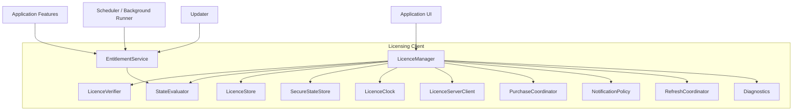
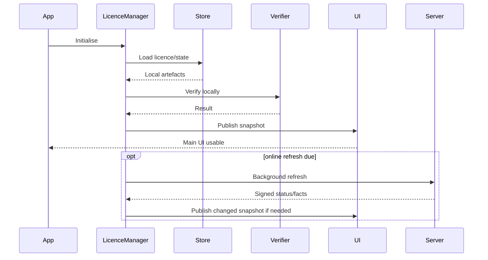
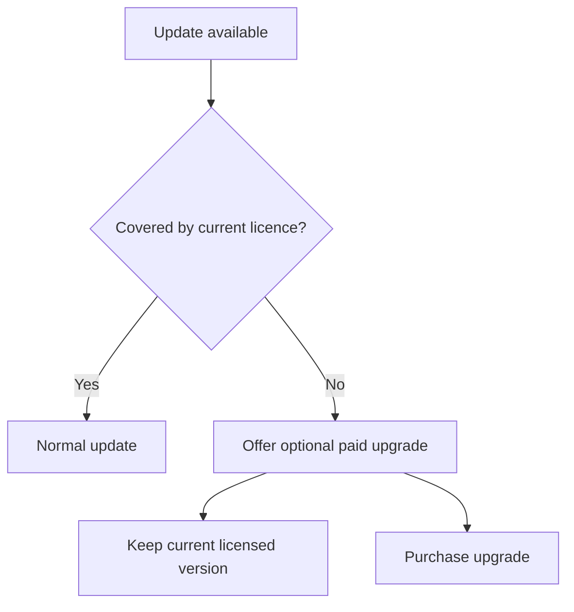
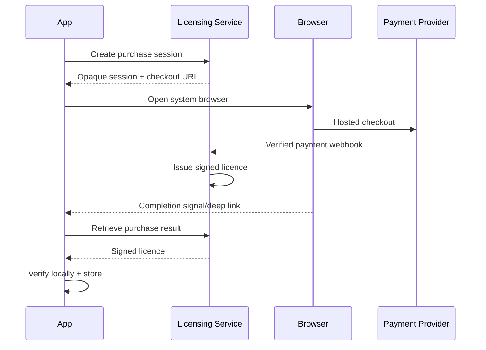

# Generic Desktop Licensing Client — Technical Architecture & UX Specification

**Status:** Proposed MVP / reusable reference architecture  
**Companion:** Generic Desktop Licensing Server — Technical Design Specification  
**Primary reference language:** Go  
**Platforms:** Windows, macOS, Linux  
**Document date:** 2026-08-15

---

# 1. Executive Summary

This specification defines the reusable **desktop-client side** of a licensing system for commercial desktop applications.

The central product rule is:

> **A legitimately issued perpetual licence remains usable without Internet access and without depending on the licensing vendor continuing to operate.**

The client is responsible for:

- acquiring and storing a signed trial licence;
- importing, redeeming and storing paid licences;
- validating all licences locally and cryptographically;
- deriving application entitlements;
- supporting fully offline operation after licence acquisition;
- handling unavailable licensing services gracefully;
- handling clock anomalies safely;
- coordinating secure purchase without handling payment-card data;
- presenting clear licence, trial and upgrade status;
- distinguishing licence expiry from version entitlement;
- preventing automatic upgrades to application versions not covered by the current licence;
- preserving user data after trial expiry or licensing failure;
- integrating licensing state with schedulers/background services;
- recovering licences after reinstall or machine replacement;
- caching signed revocation/status facts;
- exposing safe diagnostics.

Normal startup MUST NOT depend on a licensing-server request.

```text
Application starts
      |
      v
Load local licence
      |
      v
Verify signature locally
      |
      v
Evaluate state + entitlements
      |
      v
Application becomes usable
      |
      +------ optional asynchronous online refresh
```

A licensing-service outage must therefore never masquerade as an invalid perpetual licence.

---

# 2. Product and UX Principles

## 2.1 Licensing should be quiet

A valid paid user should rarely think about licensing.

A valid perpetual licence SHOULD normally result in:

```text
no modal dialog
no startup delay
no repeated network request
no countdown
no recurring banner
```

Licence UI becomes prominent only when the user needs to take action.

## 2.2 Offline is not an error

Licence validity and connectivity are separate dimensions:

```text
valid perpetual licence + offline = licensed
valid trial + before expiry + offline = licensed trial
```

Do not show an alarming "Unable to verify licence" message merely because the server cannot be reached.

## 2.3 Ownership must be explicit

For perpetual sales, purchase UX SHOULD say:

> **One-time purchase. No subscription.**

Status SHOULD say:

> **Perpetual licence**

rather than ambiguous subscription language such as "active plan".

## 2.4 Version entitlement is not licence expiry

If a perpetual licence covers version 1.x and version 2 exists:

Correct:

> **Version 2 requires an optional licence upgrade. Your version 1.x licence remains valid indefinitely.**

Incorrect:

> Your licence expired.

This distinction is both a technical and UX requirement.

## 2.5 Never hold user data hostage

When licence state disables paid capabilities, the application SHOULD retain:

- application launch;
- viewing of user-created data;
- export;
- licence settings;
- licence import;
- purchase/upgrade/recovery controls.

The application MUST NOT delete user content because a trial or timed licence expires.

## 2.6 Every licensing message answers four questions

1. What happened?
2. What is affected?
3. What remains available?
4. What can the user do next?

Example:

> **Your 30-day trial ended on 14 September 2026 at 07:30.**  
> Existing data remains available. New task execution and scheduled runs are paused.  
> Buy a perpetual licence or import an existing licence to continue.

---

# 3. Goals

The client SHALL support:

- first-run unlicensed state;
- trial acquisition online;
- active trial online and offline;
- trial expiry;
- perpetual licence online and offline;
- future time-limited licence types;
- feature entitlements;
- major-version entitlement;
- optional maintenance-date entitlement;
- licence import;
- activation-code redemption;
- purchase through an external browser;
- interrupted-purchase recovery;
- licence restoration;
- product mismatch;
- corrupted/modified licence;
- untrusted issuer;
- unsupported licence schema;
- licence not yet valid;
- confirmed revocation;
- licensing server unavailable;
- TLS failure;
- proxy failure;
- API incompatibility;
- suspicious clock changes;
- secure local-storage failure;
- reinstall/machine migration;
- application update compatibility;
- scheduled/background task enforcement;
- machine-readable diagnostics;
- localisation and accessibility.

---

# 4. Non-Goals

The client SHALL NOT implement:

- unbreakable DRM;
- kernel anti-tamper;
- mandatory periodic phone-home;
- hidden hardware fingerprinting by default;
- credit-card collection;
- payment-card storage;
- private signing keys;
- shared licence-signing HMAC secrets;
- silent TLS bypass;
- server-delivered executable feature code;
- deletion/encryption of user data after expiry;
- automatic installation of a major version the user does not own.

---

# 5. Trust Model

The companion server issues a signed licence artefact conceptually like:

```text
LIC1.<issuer-key-id>.<payload>.<signature>
```

The client contains trusted root public keys:

```text
Trusted Root Public Key
          |
          | verifies
          v
Issuer Certificate
          |
          | supplies issuer public key
          v
Signed Licence
```

The client contains no licence-signing secret.

The signed licence remains independently verifiable if the licensing server disappears.

---

# 6. Architecture



---

# 7. Component Responsibilities

## 7.1 LicenceManager

Single façade for the rest of the application.

```go
type LicenceManager interface {
    Current(ctx context.Context) LicenceSnapshot

    StartTrial(ctx context.Context) error
    ImportLicence(ctx context.Context, artifact []byte) error
    RedeemActivationCode(ctx context.Context, code string) error

    BeginPurchase(ctx context.Context) (*PurchaseSession, error)
    ResumePurchase(ctx context.Context) error

    Refresh(ctx context.Context, reason RefreshReason) error
    Can(capability Capability) Decision

    Subscribe(listener func(LicenceSnapshot)) func()
}
```

No feature module should parse licence files independently.

## 7.2 LicenceVerifier

Pure local component.

Responsibilities:

- parse envelope;
- enforce size limits;
- verify root-signed issuer certificate;
- verify licence signature;
- parse only verified payload;
- validate schema;
- validate product;
- validate issuer authority at issue time;
- enforce `not_before`;
- enforce `expires_at`;
- evaluate app major version;
- evaluate maintenance date;
- expose signed entitlements.

It MUST NOT:

- perform HTTP;
- mutate UI;
- write files;
- invoke payment systems.

## 7.3 LicenceStore

Stores signed licence artefacts.

Recommended:

```text
<app-data>/licensing/licence.lic
<app-data>/licensing/licence.previous.lic
```

Store atomically:

```text
write temp -> flush/fsync -> rename
```

Never overwrite the only known-good licence with an unverified candidate.

## 7.4 SecureStateStore

Stores local state resistant to casual editing:

- installation ID;
- trial high-water time;
- trusted online time;
- pending purchase-session token;
- signed revocation proof reference;
- last successful online check;
- notification deduplication state.

Platform implementations:

### Windows
Use Windows DPAPI for protected state.

### macOS
Use Keychain Services.

### Linux
Use Freedesktop Secret Service where available.

### Linux fallback
On minimal/headless Linux without Secret Service:

- store only necessary non-secret state in the user's private config directory;
- enforce restrictive permissions;
- document reduced anti-tamper strength;
- do not make the product unusable.

The signed licence itself does not require secret storage; integrity is provided by its signature.

## 7.5 LicenceClock

Centralises all licensing time decisions.

No feature should independently call `time.Now()` and interpret licence expiry.

Responsibilities:

- wall clock;
- monotonic elapsed time within process;
- persisted high-water mark;
- trusted server time;
- suspicious clock classification.

## 7.6 LicenceServerClient

Responsibilities:

- HTTPS transport;
- trial acquisition;
- activation redemption;
- purchase-session/status calls;
- optional revocation/status refresh;
- retry classification;
- API compatibility.

It does not decide local validity.

## 7.7 EntitlementService

Application code asks:

```go
decision := licensing.Can(CapabilityRemoteExecution)
```

not:

```go
if licence.Type == "pro" { ... }
```

Example:

```go
type Capability string

const (
    CapabilityCore          Capability = "core"
    CapabilityExecute       Capability = "execute"
    CapabilitySchedule      Capability = "scheduling"
    CapabilityRemoteExecute Capability = "remote_execution"
    CapabilityPipeline      Capability = "pipelines"
)
```

---

# 8. Licence Snapshot

The UI consumes a stable, verified model:

```go
type LicenceSnapshot struct {
    State             LicenceState
    Connectivity      ConnectivityState

    LicenceID         string
    LicenceType       LicenceType
    ProductID         string

    IssuedAt          *time.Time
    ExpiresAt         *time.Time
    MaxMajorVersion   *int
    MaintenanceUntil  *time.Time

    Entitlements      map[Capability]bool

    LastOnlineCheck   *time.Time
    LastTrustedTime   *time.Time

    PurchaseAvailable bool
    UpgradeAvailable  bool

    MessageKey        string
    DiagnosticCode    string
}
```

Key rule:

```text
LicenceState != ConnectivityState
```

---

# 9. Connectivity States

```go
type ConnectivityState string

const (
    ConnectivityUnknown      ConnectivityState = "unknown"
    ConnectivityOnline       ConnectivityState = "online"
    ConnectivityOffline      ConnectivityState = "offline"
    ConnectivityServerDown   ConnectivityState = "server_unavailable"
    ConnectivityTLSFailure   ConnectivityState = "tls_failure"
    ConnectivityProxyFailure ConnectivityState = "proxy_failure"
    ConnectivityAPIMismatch  ConnectivityState = "api_mismatch"
)
```

Connectivity is contextual information, not a licence verdict.

---

# 10. Licence States

```go
type LicenceState string

const (
    StateUnlicensed           LicenceState = "unlicensed"

    StateTrialActive          LicenceState = "trial_active"
    StateTrialExpiring        LicenceState = "trial_expiring"
    StateTrialExpired         LicenceState = "trial_expired"
    StateTrialTimeUncertain   LicenceState = "trial_time_uncertain"

    StatePerpetualValid       LicenceState = "perpetual_valid"
    StateTimedValid           LicenceState = "timed_valid"
    StateTimedExpiring        LicenceState = "timed_expiring"
    StateTimedExpired         LicenceState = "timed_expired"

    StateVersionNotEntitled   LicenceState = "version_not_entitled"
    StateMaintenanceOutOfDate LicenceState = "maintenance_out_of_date"

    StateNotYetValid          LicenceState = "not_yet_valid"
    StateRevoked              LicenceState = "revoked"

    StateInvalidSignature     LicenceState = "invalid_signature"
    StateCorrupt              LicenceState = "corrupt"
    StateProductMismatch      LicenceState = "product_mismatch"
    StateUnsupportedFormat    LicenceState = "unsupported_format"
    StateUntrustedIssuer      LicenceState = "untrusted_issuer"

    StateStorageError         LicenceState = "storage_error"
)
```

Do not collapse these into one generic "invalid licence" state.

---

# 11. State Evaluation Precedence

Evaluate deterministically:

```text
1. no licence
2. local storage/read failure
3. malformed envelope
4. unsupported format
5. invalid/untrusted issuer certificate
6. invalid licence signature
7. product mismatch
8. issuer not authorised when licence was issued
9. confirmed signed revocation
10. not-before violation
11. clock anomaly
12. signed time expiry
13. app-version entitlement
14. maintenance entitlement
15. valid
```

Untrusted payload fields MUST NOT drive UX until cryptographic verification succeeds.

---

# 12. State Matrix

| Local licence | Time | App version | Network | Effective result |
|---|---|---|---|---|
| none | n/a | n/a | online | Unlicensed; trial/buy/import available |
| none | n/a | n/a | offline | Unlicensed; import available; new trial/purchase unavailable |
| valid trial | before expiry | covered | online | Trial active |
| valid trial | before expiry | covered | offline | Trial active offline |
| valid trial | near expiry | covered | any | Trial expiring |
| valid trial | after expiry | covered | any | Trial expired |
| valid perpetual | n/a | covered | online | Licensed |
| valid perpetual | n/a | covered | offline | Licensed |
| valid perpetual | n/a | app major too new | any | Version not entitled |
| valid timed | before expiry | covered | offline | Licensed until signed expiry |
| valid timed | after expiry | covered | offline | Timed licence expired |
| invalid signature | any | any | any | Invalid licence |
| wrong product | any | any | any | Product mismatch |
| valid local | valid | covered | server down | Licensed; online operations unavailable |
| valid local | valid | covered | TLS failure | Licensed; secure online operations unavailable |
| signed revocation cached | any | any | any | Revoked |
| valid trial | suspicious clock | covered | offline | Time-uncertain policy |
| perpetual | clock anomaly | covered | any | Licensed |

---

# 13. Startup

Startup MUST be local-first:



Target local licensing evaluation:

```text
< 50 ms on ordinary hardware
```

No DNS, HTTP or server wait belongs on the critical startup path.

---

# 14. First-Run UX

When no licence exists:

> **Welcome to \<Product\>**
>
> **Try it free for 30 days**  
> Full functionality during the trial. No payment details required.
>
> **[ Start 30-day trial ]**
>
> **[ Buy a perpetual licence ]**
>
> Already own a licence?  
> **[ Import licence file ] [ Enter activation code ]**
>
> **One-time purchase. No subscription.**

Do not require account creation unless the product itself genuinely needs an account.

---

# 15. First Run Offline

> **You're currently offline.**  
> A connection is required to start a new trial or purchase a licence.  
> If you already own a licence, you can import its licence file now.
>
> **[ Import licence ] [ Try connection again ]**

If activation code redemption requires the server, disable that action with explicit explanatory text.

A signed `.lic` file is importable completely offline.

---

# 16. Trial Acquisition

Flow:

```text
Start trial
    |
load/generate random installation ID
    |
POST /v1/trials
    |
receive signed trial licence
    |
verify locally
    |
store atomically
    |
show confirmation
```

The client MUST verify the signed artefact even when received over TLS.

### Success

> **30-day trial started**  
> Your trial runs until **14 September 2026 at 07:30**.  
> The application will continue to work offline during the trial.

### No connection

> **A connection is required to start your trial.**  
> No trial has been started yet. Check your connection and try again.

### Server unavailable

> **The licensing service is temporarily unavailable.**  
> No trial has been started or consumed. Try again later.

### TLS failure

> **A secure connection to the licensing service could not be established.**  
> Check your device date/time, proxy or network configuration. The application will not bypass certificate validation.

### Trial already used

> **A trial has already been used on this installation.**  
> The previous trial ended on **14 September 2026**. You can buy a licence or import one you already own.

Never use accusatory language such as "trial abuse detected".

---

# 17. Trial Notification Policy

Recommended 30-day cadence:

```text
start          confirmation only
7 days left    informational banner
3 days left    persistent dismissible banner
24 hours left  persistent banner with exact expiry
4 hours left   only if scheduled/background work exists
expiry         clear state transition
```

Do not nag every day.

### 7-day wording

> **7 days left in your trial**  
> Trial ends **14 September 2026 at 07:30**.  
> **[ Buy perpetual licence ] [ Dismiss ]**

### 24-hour wording

> **Your trial ends tomorrow at 07:30.**  
> Your data will remain available. New task execution and scheduled runs will pause when the trial ends.  
> **[ Buy perpetual licence ]**

Use exact dates/times alongside relative language.

---

# 18. Trial Expiry Semantics

At expiry:

```text
no new licensed operation starts
already-running operation may finish
new scheduled runs do not start
configured schedules remain stored
user data remains visible
export remains available
purchase/import remains available
```

Do not terminate a remote command or pipeline halfway through solely because the expiry timestamp passed.

---

# 19. Trial Expired UX

> **Your 30-day trial ended on 14 September 2026 at 07:30.**  
> Your data, tasks, history and settings are unchanged. New execution and scheduled runs are paused until a licence is installed.
>
> **Perpetual licence — €79 one-time**
>
> **[ Buy licence ] [ Import existing licence ]**

Price is product configuration, not hard-coded into the generic library.

If final tax is unknown:

> Taxes, where applicable, are calculated during checkout.

---

# 20. Perpetual Licence UX

Normal operation:

```text
no banner
no periodic activation prompt
no online requirement
```

Licence settings:

```text
Status              Licensed
Licence             Perpetual
Version entitlement 1.x
Licensed to         Example Customer     optional
Licence ID          lic_…A92F
Last online check   12 August 2026        optional
```

Supporting text:

> **This licence works offline and does not expire.**

---

# 21. Offline Perpetual Operation

A valid perpetual licence MUST continue to work when:

- Internet is unavailable;
- DNS fails;
- the licence server is down;
- the user is behind an incompatible firewall;
- the user is on an isolated network;
- the vendor has ceased operating.

Do not implement a disguised expiry such as:

```text
phone home every 30/60/90 days
```

for this perpetual model.

---

# 22. Online Status Checking

Optional status refresh MAY occur:

- after licence installation;
- occasionally in background;
- when user chooses "Check licence status";
- before a server-dependent licence operation.

It MUST NOT block startup.

If refresh fails:

```text
preserve current locally verified licence state
record connectivity failure
retry later with backoff
```

For perpetual licences, an old "last checked" timestamp is informational only.

---

# 23. Signed Revocation

A plain response:

```json
{"revoked": true}
```

SHOULD NOT permanently change a local perpetual licence.

Prefer a signed revocation record:

```json
{
  "schema_version": 1,
  "licence_id": "lic_...",
  "revoked_at": "2026-08-15T07:00:00Z",
  "reason_code": "chargeback",
  "issuer_key_id": "issuer-2026-01"
}
```

The client verifies and caches the signed proof.

---

# 24. Revocation UX

> **This licence was revoked on 15 August 2026.**  
> It can no longer enable paid features. Your local data remains available and can be exported.
>
> **[ View licence details ] [ Contact support ] [ Buy a new licence ]**

If safe:

> Reason: payment reversed

Never accuse the user of fraud.

An offline client can only enforce revocation once it has securely learned it; instant revocation of a permanently offline licence is impossible by design.

---

# 25. Version Entitlement

Example signed licence:

```json
{
  "max_major_version": 1
}
```

Application 1.8:

```text
licensed
```

Application 2.0:

```text
version_not_entitled
```

This is not expiry.

---

# 26. Updater Integration

The updater MUST check entitlement before installing.



Never silently upgrade a v1 owner into an unlicensed v2.

---

# 27. Major Upgrade UX

> **Version 2 is available**  
> Your perpetual licence covers all version 1.x releases. Version 2 is an optional paid upgrade. Your current version will continue to work indefinitely.
>
> Upgrade price: **€39 one-time**
>
> **[ See what's new ] [ Buy upgrade ] [ Stay on version 1 ]**

Avoid "licence out of date" or "licence expired".

---

# 28. User Manually Installs New Major Version

If a v1 owner launches v2:

> **Your licence covers version 1.x. This application is version 2.**  
> Your existing licence has not expired. You can buy the version 2 upgrade, import another licence, or continue using version 1.
>
> **[ Buy upgrade ] [ Import licence ] [ Find version 1 ]**

Where possible, v2 still provides view/export mode.

---

# 29. Maintenance-Date Model

For products using:

```json
{
  "maintenance_until": "2027-08-15T00:00:00Z"
}
```

interpretation SHOULD be:

> builds released on/before that date are entitled.

The software does not stop working on the maintenance date.

Release-date metadata used for entitlement MUST be trusted/signed by the software-update system; do not rely on local file timestamps.

---

# 30. Unsupported Format

> **This licence uses a newer licence format.**  
> Update \<Product\> to use this licence. The licence file has not been changed or deleted.
>
> **[ Check for compatible update ] [ Choose another licence ]**

Diagnostic:

```text
LIC_FORMAT_TOO_NEW
```

Do not call it invalid.

---

# 31. Untrusted Issuer

Possible causes:

- corrupted issuer certificate;
- old app does not know a newly introduced root;
- artefact belongs to another trust ecosystem;
- tampering.

UX:

> **This licence was signed by an issuer this version of \<Product\> does not trust.**  
> If it was issued recently, update the application and try again.
>
> **[ Check for update ] [ Choose another licence ]**

Never trust a new root key merely because the untrusted server response supplies it.

---

# 32. Invalid Signature

> **This licence could not be verified.**  
> The licence file may be damaged, incomplete or modified. Your existing valid licence has not been deleted.
>
> **[ Import again ] [ Restore licence ] [ View details ]**

Do not say "pirated licence detected".

---

# 33. Product Mismatch

> **This licence is for \<Other Product\>, not \<Current Product\>.**  
> Choose a licence issued for \<Current Product\>.

This is a normal user-correctable condition.

---

# 34. Not-Yet-Valid Licence

> **This licence becomes valid on 1 September 2026 at 00:00 UTC.**  
> Check your device date and time if this is unexpected.
>
> **[ Verify date online ]**

---

# 35. Clock Model

Time primarily affects:

- trials;
- timed licences;
- `not_before`;
- maintenance rules.

A perpetual licence with no time-limited entitlement MUST NOT be invalidated by a clock change.

---

# 36. Trial High-Water Time

Persist a protected high-water mark.

Basic evaluation:

```go
effectiveNow := localNow
if highWater.After(effectiveNow) {
    effectiveNow = highWater
}
```

This prevents simple local clock rollback from extending a trial.

However, clock anomalies must be recoverable.

---

# 37. Accidental Future Clock

Example:

```text
real date: 2026
machine accidentally set to: 2036
trial appears expired
machine corrected to: 2026
```

If a trusted online time/status check succeeds, the client MAY correct an obviously anomalous local high-water mark according to server-signed trial facts.

Do not create an irreversible client-side lockout.

---

# 38. Clock-Suspicion Policy

Suggested:

```text
rollback < 10 minutes:
    normal adjustment

larger rollback on active trial:
    use high-water mark silently

huge future jump that changes entitlement:
    show time uncertainty and offer online verification
```

UX:

> **The device date or time appears to have changed significantly.**  
> Connect to verify the trial date, or check your system clock.
>
> **[ Verify online ] [ Open date/time settings ]**

---

# 39. Trusted Time

Prefer server responses containing signed current-time/status data.

A successful authenticated TLS call can also establish useful trusted time, but signed status is better for durable caching and multi-process verification.

---

# 40. Network Security

Production calls MUST use HTTPS.

Preferred minimum:

```text
TLS 1.3
```

The client SHOULD use the normal OS/system trust store.

Do not provide:

```text
Ignore certificate errors
```

as a licensing setting.

---

# 41. Certificate Pinning

Do not pin certificates in the MVP.

Reasons:

- certificate rotation;
- corporate TLS interception;
- recovery complexity;
- risk of self-inflicted outage.

If introduced later, use multiple staged pins and an explicit rotation design.

---

# 42. Proxy Support

Technical users may operate behind:

- enterprise HTTP proxies;
- authenticated proxies;
- VPNs;
- TLS inspection.

Default:

```text
Use system proxy settings
```

Optional advanced modes:

```text
Use system proxy
No proxy
Manual proxy
```

Manual proxy secrets go into the OS secure store.

---

# 43. Network Error Classification

Internally distinguish:

```text
DNS failure
connection timeout
connection refused
TLS validation failure
proxy authentication failure
HTTP 429
HTTP 5xx
API incompatibility
malformed/suspicious response
```

Do not collapse all of these into "No Internet".

---

# 44. Retry

Background retry uses exponential backoff with jitter, for example:

```text
5s -> 15s -> 1m -> 5m -> 30m -> 2h -> 12h
```

Reset after success.

User-triggered actions may provide an immediate **Try again**.

---

# 45. Server-Outage UX

For a valid perpetual user during normal work:

```text
show nothing
```

In licence settings:

> Last online status check unavailable. Your perpetual licence remains valid offline.

During purchase:

> **The licensing service is temporarily unavailable.**  
> Your existing licence is unaffected. Purchase could not be started.
>
> **[ Try again ]**

During active trial:

```text
no warning unless an online operation was requested
```

---

# 46. API Incompatibility

If online licensing API requires a newer client:

> **Online licensing services require a newer version of \<Product\>.**  
> Your current local licence remains valid. Update the application to use online licence management.
>
> **[ Check for update ]**

Do not disable valid local features.

---

# 47. Secure Store Failure

If Keychain/DPAPI/Secret Service fails but a signed perpetual licence remains readable:

```text
perpetual entitlement remains valid
```

UX only when relevant:

> **Secure local storage is unavailable.**  
> Your licence is still valid, but some licence-management state cannot currently be saved.

For minimal Linux systems, follow the documented fallback rather than refusing to run.

---

# 48. Licence Import

Support:

- file picker;
- drag/drop `.lic`;
- paste licence text.

Safe sequence:

```text
read candidate
verify candidate completely
compare to current licence
show consequences if needed
atomically store
```

Never overwrite a valid existing licence before candidate verification.

---

# 49. Import Success

> **Licence installed**  
> Perpetual licence for \<Product\> version 1.x.  
> No Internet connection is required for normal use.

---

# 50. Replacing a Licence

If the replacement is a downgrade, warn:

> **The selected licence provides fewer entitlements than your current licence. Replace it anyway?**

Keep a valid rollback copy where appropriate.

---

# 51. Licence Export

For portable perpetual licences:

```text
Settings > Licence > Save licence file
```

Message:

> Keep this file somewhere safe. It can be used to restore your licence on another machine.

The signed licence is not a signing secret, but it is valuable paid entitlement material.

---

# 52. Installation Identity

For trials generate a random installation ID using a cryptographically secure random source.

Do not derive it from:

- MAC address;
- disk serial;
- motherboard serial;
- CPU ID;
- Windows SID;

unless a future explicit licensing policy requires hardware binding.

---

# 53. Machine Replacement

Portable named-user model:

```text
old machine -> save/copy licence.lic
new machine -> import licence.lic
```

No deactivation step is required in the basic model.

If seat/device limits are introduced later, make device management explicit rather than failing mysteriously.

---

# 54. Reinstall Recovery

Offer:

```text
Already purchased?

[ Import licence file ]
[ Enter activation code ]
[ Restore purchase ]
```

Preferred recovery order:

1. licence file;
2. activation code;
3. server-side purchase recovery;
4. support.

---

# 55. Activation Redemption

Flow:

```text
enter code
normalize formatting
POST activation
receive signed licence
verify locally
store
discard plaintext code
```

Plaintext activation codes MUST NOT remain in:

- logs;
- telemetry;
- crash reports;
- long-term config;
- command history.

### Invalid

> **That activation code was not recognised.**  
> Check the code and try again.

### Already redeemed

> **This activation code has already been redeemed.**  
> If it belongs to you, use Restore Purchase or contact support.

### Offline

> **A connection is required to redeem an activation code.**  
> If you have a licence file, you can import it offline.

---

# 56. Purchase Architecture

The desktop app MUST NOT collect payment-card details.



The browser callback is not proof of payment.

Only a valid signed licence unlocks the desktop app.

---

# 57. System Browser

Prefer the default/system browser over an embedded WebView.

Benefits:

- visible payment origin;
- password manager support;
- payment-provider compatibility;
- 3-D Secure support;
- reduced PCI/security scope;
- no card entry inside application UI.

---

# 58. Purchase UX

Example:

> **Perpetual licence**
>
> **€79 one-time**  
> No subscription.  
> Includes all version 1.x updates.  
> Future major upgrades are optional.
>
> **[ Buy licence ]**
>
> Taxes, where applicable, are calculated securely during checkout.

Commercial price SHOULD come from trusted offer data or product configuration.

---

# 59. Purchase In Progress

After opening browser:

> **Complete your purchase in your browser.**  
> This window can stay open while payment is processed.
>
> **[ Check purchase ] [ Open checkout again ] [ Cancel ]**

Do not show an indefinite unexplained spinner.

---

# 60. Purchase Completion

After the signed licence verifies:

> **Purchase complete — licence installed**  
> You now own a perpetual licence for \<Product\> version 1.x.  
> No subscription is required.
>
> **[ Continue ]**

---

# 61. Payment Succeeded but Retrieval Failed

This is a first-class recovery state.

Persist an opaque purchase-session reference **before** opening checkout.

On next launch:

> **A previous purchase may be complete.**  
> We can check the licensing service and install your licence if payment succeeded.
>
> **[ Check purchase ]**

Never prompt the user to pay again before checking.

---

# 62. Purchase State Model

```text
created
checkout_open
payment_pending
paid_licence_pending
licence_ready
cancelled
expired
failed
```

Client rules:

```text
licence_ready -> fetch, verify, store
payment_pending -> wait/check later
expired -> allow new session
failed -> show neutral failure
unknown -> diagnostics; never start a second charge automatically
```

---

# 63. Deep-Link Security

Example:

```text
myproduct://licensing/purchase-complete?session=<opaque>
```

Deep-link values are untrusted.

Never put:

```text
paid=true
entitlements=...
unsigned licence JSON
payment data
```

in the callback.

The callback only identifies a server-side session to query.

---

# 64. Loopback Callback Alternative

If using a localhost callback:

- bind only to loopback;
- random high port;
- high-entropy state nonce;
- one successful completion;
- timeout;
- verify purchase with licensing server.

Callback still does not unlock the application by itself.

---

# 65. Checkout Closed

Closing browser is ambiguous.

UX:

> **Checkout closed**  
> No new licence has been installed. If you completed payment in another tab or window, choose **Check purchase** before starting another purchase.

This reduces duplicate purchases.

---

# 66. Price Caching

Offline display may show:

> **Last known price: €79. Connect to confirm current price and purchase.**

The checkout server is authoritative for the final transaction total.

---

# 67. Licence Settings Screen

Example:

```text
Licence
────────────────────────────────
Status               Licensed
Type                 Perpetual
Product              Example Product
Version entitlement  1.x
Licence ID           lic_…92AF
Issued               15 August 2026
Last online check    15 August 2026

This licence works offline.

[ Save licence file ]
[ Import another licence ]
[ Check licence status ]
[ Copy diagnostics ]
```

Trial example:

```text
Status          Trial
Time remaining  6 days
Ends            21 August 2026 at 08:30
```

---

# 68. Notification Severity

Use four levels:

## Informational
- trial started;
- purchase completed;
- licence imported.

Presentation: toast/transient confirmation.

## Advisory
- 7 days remaining;
- optional major upgrade.

Presentation: dismissible banner/settings indicator.

## Action Required
- trial expires within 24h and scheduled jobs exist;
- current executable major version is not entitled.

Presentation: persistent banner and CTA.

## Blocking
- user attempts a licensed operation after expiry;
- confirmed revocation;
- no valid licence for requested operation.

Presentation: contextual blocking message.

Avoid blocking the whole application where read/export remains meaningful.

---

# 69. Notification Deduplication

Persist:

```text
trial_7d_shown
trial_3d_shown
trial_24h_shown
upgrade_notice_major=2
revocation_notice_id=...
```

Do not show the same message every launch after dismissal unless:

- severity increases;
- facts change;
- the user retries a blocked operation.

---

# 70. Exact Dates and Timezones

Store/evaluate UTC.

Display local time:

> Trial ends **14 September 2026 at 07:30 (local time)**.

Diagnostics use RFC3339 UTC:

```text
2026-09-14T06:30:00Z
```

---

# 71. Scheduler Integration

The scheduler MUST consult entitlements at execution time:

```go
decision := licensing.Can(CapabilitySchedule)
if !decision.Allowed {
    scheduler.RecordSkipped(jobID, decision.Reason)
    return
}
```

Do not rely on disabled UI buttons; background jobs may run with the GUI closed.

---

# 72. Scheduled Jobs Near Expiry

If schedules exist, show stronger notice:

> **Your trial ends on 14 September 2026 at 07:30.**  
> 12 scheduled tasks are configured. New scheduled runs will pause after the trial ends unless a licence is installed.
>
> **[ Buy licence ] [ View schedules ]**

At expiry:

- do not delete schedules;
- record skipped run reason;
- preserve next-run configuration;
- resume normal scheduling automatically when a valid licence is installed.

---

# 73. Scheduler Audit Reason

```json
{
  "result": "skipped",
  "reason": "licence_trial_expired",
  "scheduled_for": "2026-09-14T08:00:00Z"
}
```

This must be distinguishable from execution failure.

---

# 74. Long-Running Operations at Expiry

Recommended policy:

```text
operation starts while valid -> may finish
new operation after expiry -> denied
```

For pipelines, acquire a bounded entitlement lease when the overall run begins so the pipeline can complete coherently.

Do not kill remote commands solely because an entitlement timestamp crosses expiry during execution.

---

# 75. Entitlement Lease

```go
type EntitlementLease struct {
    Capability Capability
    GrantedAt  time.Time
    RunID      string
}
```

A lease authorises only the operation for which it was granted.

It is not a reusable bypass.

---

# 76. Separate Background Service

If the product has GUI + scheduler service:

```text
GUI process ----\
                 > signed licence.lic
service process -/
```

Both processes independently verify the licence.

Do not let a privileged service blindly trust an IPC boolean such as:

```json
{"licensed": true}
```

---

# 77. Multi-Process Storage

Licence replacement must be atomic.

Use file watching or IPC notification after a successful replacement.

Shared protected-state writes require locking.

No process should observe a partially written licence.

---

# 78. Revocation Across Processes

Store the signed revocation proof in shared licensing state accessible to the relevant user/service.

Every process validates it.

---

# 79. Local IPC

If licence management is exposed over IPC:

- restrict peer to current user/session where possible;
- enforce message-size limits;
- revalidate all imported licence bytes;
- do not expose "set entitlement=true";
- authenticate privileged service peers where platform allows.

---

# 80. Go Package Layout

```text
/licensing
  manager.go
  state.go
  snapshot.go
  entitlements.go
  clock.go

  /format
    envelope.go
    issuer.go
    verify.go

  /store
    licence.go
    secure.go
    secure_windows.go
    secure_darwin.go
    secure_linux.go

  /server
    client.go
    errors.go
    retry.go

  /purchase
    coordinator.go
    deeplink.go

  /notify
    policy.go

  /diagnostics
    report.go
```

UI-specific adapters remain outside the core package.

---

# 81. Pure Verification API

```go
type VerifyInput struct {
    Artifact       []byte
    ProductID      string
    AppVersion     Version
    AppReleaseDate *time.Time
    Now            time.Time
    TrustedRoots   []TrustedRoot
    Revocations    []SignedRevocation
}

type VerifyResult struct {
    State          LicenceState
    Licence        *VerifiedLicence
    Entitlements   map[Capability]bool
    DiagnosticCode string
}
```

The verifier must be deterministic under an injected time.

---

# 82. Verification Skeleton

Illustrative:

```go
func VerifyEnvelope(roots []TrustedRoot, artifact []byte) (*VerifiedEnvelope, error) {
    env, err := ParseEnvelope(artifact)
    if err != nil {
        return nil, ErrCorrupt
    }

    cert, err := ParseIssuerCertificate(env.IssuerCertificate)
    if err != nil {
        return nil, ErrInvalidIssuerCertificate
    }

    if !VerifyWithTrustedRoot(roots, cert) {
        return nil, ErrUntrustedIssuer
    }

    if len(cert.PublicKey) != ed25519.PublicKeySize {
        return nil, ErrInvalidIssuerCertificate
    }

    if !ed25519.Verify(
        ed25519.PublicKey(cert.PublicKey),
        env.SignatureInput(),
        env.Signature,
    ) {
        return nil, ErrInvalidSignature
    }

    return &VerifiedEnvelope{Envelope: env, Issuer: cert}, nil
}
```

Do not act on unverified payload fields.

---

# 83. Input Limits

Suggested:

```text
licence artefact         64 KiB max
issuer certificate        8 KiB max
payload                   32 KiB max
entitlements              256 max
metadata                  16 KiB max
```

Reject pathological allocations.

---

# 84. Parser Hardening

The parser SHALL:

- reject malformed envelopes;
- reject unsafe unsupported versions;
- enforce base64url rules;
- enforce Ed25519 key/signature lengths;
- enforce timestamp format;
- reject excessive collection sizes;
- reject invalid string encodings;
- avoid unbounded recursion;
- fuzz-test all external input parsers.

Where JSON duplicate-field semantics are security-sensitive, reject duplicates or use a parser strategy that can detect them.

---

# 85. Root Keyring

The companion implementation publishes `github.com/matthogan/licenceserver/client/verifier`, a standard-library-only Go package with a serializable public keyring, per-root issuer-authority bounds and strict licence/status/transition verification. Its v1 API uses typed error codes and injected clocks and has no dependency on the server's internal packages.

Use:

```go
type TrustStore struct {
    Roots map[string]ed25519.PublicKey
}
```

rather than one hard-coded root variable.

Future application releases can contain:

```text
root-2026
root-2031
```

for staged rotation.

---

# 86. Root-Key Update

The implemented cross-signing format is:

```text
RKT1.<base64url-canonical-json>.<old-ed25519-signature>.<new-ed25519-signature>
```

The domain-separated payload binds both root IDs/public keys, `created_at`, `not_before`, `overlap_until`, `expires_at`, and a reason. A client applies it only while `not_before <= now < expires_at`, when one endpoint is already trusted and both signatures verify. The new root accepts issuer authorities beginning at or after `not_before`. The old root accepts only authorities beginning before `overlap_until`, preserving historical perpetual licences after routine cutover. A compromise update removes the affected root entirely and may invalidate licences chained to it.

Persist keyring replacement atomically and never learn compromise/rollback state from an unauthenticated licensing response. Cross-language acceptance vectors are published in `docs/root-transition-test-vectors-v1.json`.

Go clients should embed the bootstrap root and open `verifier.KeyringStore`. The store validates every persisted successor against the signed chain, applies RKT1 only during its installation window, limits rollback to overlap, excludes compromised roots and swaps its in-memory snapshot only after a synced atomic file replacement succeeds. Platform examples and the incident procedure are in `docs/client-verifier-integration.md`.

A normal API response cannot install a new root trust anchor.

New roots must arrive through:

- trusted application release/update distribution; or
- a pre-designed cross-signing mechanism rooted in an already trusted key.

Routine rotation should occur at issuer level, not root level.

---

# 87. Issuer Certificate Semantics

`authority_not_after` means:

> last time this issuer was authorised to issue a licence.

For historical perpetual verification, check:

```text
licence.issued_at within issuer authority window
```

Do NOT require:

```text
current time within issuer authority window
```

otherwise routine issuer rotation would accidentally expire old perpetual licences.

---

# 88. Licence File Resilience

Signature protects integrity.

Availability protection:

```text
licence.lic
licence.previous.lic
```

If primary becomes corrupt:

1. validate backup;
2. restore it if it is the same/newer valid commercial state;
3. never silently replace a paid licence with an older trial.

---

# 89. Local Secure State Example

```json
{
  "schema_version": 1,
  "installation_id": "random-id",
  "trial_time_high_water": "2026-08-15T07:20:00Z",
  "last_trusted_server_time": "2026-08-15T07:18:00Z",
  "last_online_check": "2026-08-15T07:18:00Z",
  "pending_purchase": {
    "session_ref": "ps_opaque",
    "created_at": "2026-08-15T07:15:00Z"
  },
  "notification_state": {
    "trial_7d": true
  }
}
```

Protect with the platform secure-state store where practical.

---

# 90. State Persistence Rule

Persist source facts, not computed state.

Persist:

```text
licence
revocation proof
clock state
last online check
purchase session
```

Recompute:

```text
trial_expired
perpetual_valid
version_not_entitled
```

at startup.

This prevents stale cached status.

---

# 91. Go HTTP Client

Illustrative:

```go
transport := &http.Transport{
    Proxy: http.ProxyFromEnvironment,
    TLSClientConfig: &tls.Config{
        MinVersion: tls.VersionTLS13,
    },
    MaxIdleConns:        20,
    IdleConnTimeout:     90 * time.Second,
    TLSHandshakeTimeout: 10 * time.Second,
}

client := &http.Client{
    Transport: transport,
    Timeout:   20 * time.Second,
}
```

All request methods accept `context.Context`.

---

# 92. Background Refresh Policy

Suggested:

```text
after licence install
when user explicitly requests
occasionally while app already online
not more than once/24h by default
never wake the machine solely to refresh
never block startup
```

Perpetual entitlement does not depend on refresh freshness.

---

# 93. Offline Detection

Do not probe arbitrary Internet hosts such as Google.

The relevant state is whether the actual licence operation succeeds.

A machine may be intentionally isolated or may access the licensing endpoint only through a private proxy.

---

# 94. Explicit Work Offline Mode

Optional setting:

```text
Work offline
```

When enabled:

- suppress background licence-server calls;
- locally valid perpetual licence continues;
- active trial continues with local clock policy;
- start-trial/purchase/redeem actions explain that online mode is required.

Useful in regulated or secure environments.

---

# 95. Privacy

Send only data needed for licensing.

Trial request:

```text
product ID
random installation ID
client version
protocol version
```

Status request:

```text
licence ID
product ID
client/protocol version
```

Do not send:

- user task contents;
- command history;
- remote host names;
- files;
- hardware inventory;
- arbitrary machine identifiers.

Licensing is not telemetry.

---

# 96. Logging

Safe structured example:

```json
{
  "component": "licensing",
  "event": "licence.verify",
  "result": "success",
  "state": "perpetual_valid",
  "licence_id_suffix": "92AF",
  "issuer_key_id": "issuer-2026-01"
}
```

Never log:

- activation code;
- full licence by default;
- purchase session secret;
- customer PII;
- secure-store plaintext.

---

# 97. Crash Reports

Allowed:

```text
licence state
diagnostic code
schema version
issuer key ID
```

Excluded:

```text
activation code
full licence
purchase token
email/PII
```

---

# 98. Message Catalogue

Use stable keys:

```text
LIC_UNLICENSED
LIC_TRIAL_ACTIVE
LIC_TRIAL_7_DAYS
LIC_TRIAL_3_DAYS
LIC_TRIAL_24_HOURS
LIC_TRIAL_EXPIRED
LIC_PERPETUAL_VALID
LIC_VERSION_UPGRADE_REQUIRED
LIC_REVOKED
LIC_INVALID_SIGNATURE
LIC_PRODUCT_MISMATCH
LIC_FORMAT_TOO_NEW
LIC_UNTRUSTED_ISSUER
LIC_NOT_YET_VALID
LIC_CLOCK_UNCERTAIN
LIC_SERVER_UNAVAILABLE
LIC_TLS_FAILURE
LIC_PROXY_FAILURE
LIC_API_UPGRADE_REQUIRED
LIC_PURCHASE_PENDING
LIC_PURCHASE_RECOVERY_AVAILABLE
LIC_SECURE_STORAGE_UNAVAILABLE
```

Do not construct translatable sentences from fragments.

---

# 99. Recommended User Messages

### Unlicensed

> **No licence is installed.**  
> Start a 30-day trial, buy a perpetual licence, or import a licence you already own.

### Trial active

> **Trial active — 12 days remaining**  
> Ends 27 August 2026 at 08:30.

### Trial expired

> **Your trial ended on 14 September 2026 at 07:30.**  
> Your data remains available. Licensed execution features are paused until a licence is installed.

### Perpetual

> **Perpetual licence — licensed**  
> This licence works offline and does not expire.

### Major upgrade

> **Version 2 requires an optional licence upgrade.**  
> Your existing version 1.x licence remains valid indefinitely.

### Server unavailable

> **The licensing service is temporarily unavailable.**  
> Your existing licence is unaffected.

### Invalid signature

> **This licence could not be verified.**  
> The licence file may be incomplete, damaged or modified.

### Revoked

> **This licence was revoked on 15 August 2026.**  
> It can no longer enable paid features. Your local data remains available.

### Clock

> **The device date or time appears to have changed significantly.**  
> Connect to verify the trial date, or check your system clock.

---

# 100. Accessibility

Licensing state MUST NOT rely on colour alone.

Use:

```text
icon + text + accessible label
```

Buttons should be explicit:

```text
Buy perpetual licence
Import licence
Check purchase
Verify online
```

Avoid ambiguous labels such as:

```text
Fix
Resolve
Continue
```

when the consequence is unclear.

All licence dialogs must be keyboard accessible and screen-reader compatible.

---

# 101. Visual Tone

Licence UI should match the application's ordinary design.

Do not make it look like an advertising landing page.

Professional technical software should treat licensing primarily as a system-status and commercial-information concern.

---

# 102. Dark Patterns Prohibited

The UI MUST NOT:

- hide that the purchase is one-time;
- create fake urgency;
- obscure dismissal;
- auto-start checkout;
- imply a recurring payment where none exists;
- call an optional major upgrade mandatory;
- hide licence import;
- disable export to force payment;
- mislabel server outage as licence failure.

---

# 103. Feature Degradation Matrix

Generic recommendation:

| State | View | Export | Edit | Run | Schedule | Remote run | Licence actions |
|---|---:|---:|---:|---:|---:|---:|---:|
| Unlicensed | yes | yes | optional | no | no | no | yes |
| Trial active | yes | yes | yes | yes | yes | yes | yes |
| Trial expired | yes | yes | optional | no | no | no | yes |
| Perpetual valid | yes | yes | yes | yes | yes | yes | yes |
| Version not entitled | yes | yes | optional | policy | policy | policy | yes |
| Invalid licence | yes | yes | optional | no | no | no | yes |
| Revoked | yes | yes | optional | no | no | no | yes |
| Server down + perpetual valid | yes | yes | yes | yes | yes | yes | online actions unavailable |

Application-specific capabilities may differ, but data accessibility should remain.

---

# 104. Version Rollback

If a user tests v2 without entitlement and returns to v1:

```text
v1 must still accept the original v1 licence
```

Do not mutate or migrate the licence itself into a v2-only representation during an unsuccessful upgrade.

---

# 105. Update-Signing Separation

Licence signatures and software-update signatures are separate trust domains.

Do not reuse the licence issuer private key to sign application binaries.

Questions are distinct:

```text
Is this application binary from the vendor?
Is this licence genuinely issued by the vendor?
```

---

# 106. Payment/Licence Separation

Likewise:

```text
payment success = commerce fact
signed licence = application entitlement
```

The desktop client consumes the signed licence.

It does not need a payment-provider SDK to decide entitlement.

---

# 107. Error Classes

Classify errors:

```text
UserCorrectable
Transient
SecuritySensitive
PermanentCommercialState
InternalBug
```

Examples:

```text
wrong activation code -> UserCorrectable
server timeout -> Transient
TLS certificate failure -> SecuritySensitive
trial expired -> PermanentCommercialState
invalid internal invariant -> InternalBug
```

---

# 108. Error-to-Action Mapping

| Condition | Primary action | Secondary |
|---|---|---|
| Offline starting trial | Try again | Import licence |
| Server 503 | Try later | Import licence |
| TLS failure | Check clock/network | Diagnostics |
| Invalid activation | Re-enter | Restore purchase |
| Trial expired | Buy licence | Import licence |
| Version not entitled | Buy upgrade | Stay on licensed version |
| Invalid signature | Re-import | Restore licence |
| Product mismatch | Choose correct licence | Details |
| Revoked | Contact support | Buy new licence |
| API too old | Update app | Continue offline |
| Secure store unavailable | Retry | Continue where safe |

---

# 109. Rate Limit

Respect server `Retry-After`.

UX:

> **Too many licensing requests were made recently.**  
> Try again in about 2 minutes.

Background logic waits automatically.

---

# 110. Server 5xx

> **The licensing service is temporarily unavailable.**  
> Your existing licence is unaffected. Try again later.

Expose request ID in diagnostics, not internal server details.

---

# 111. Desktop Client Has No Admin Authority

The ordinary app can call only public operations such as:

- start trial;
- redeem activation;
- retrieve purchase result;
- check status.

It never contains an admin token that can mint perpetual licences.

---

# 112. CLI Integration

If the product has a CLI:

```text
myapp licence status
myapp licence import ./licence.lic
myapp licence activate
myapp licence trial start
myapp licence purchase
myapp licence diagnostics
```

Support:

```text
--json
```

Avoid activation codes in command arguments. Prefer hidden prompt/stdin to avoid shell history/process exposure.

Suggested exit codes:

```text
0  success
2  invalid arguments
10 unlicensed
11 trial expired
12 licence invalid
13 version not entitled
14 revoked
20 network unavailable
21 TLS failure
22 server unavailable
30 local storage error
```

---

# 113. Headless Mode

Background/headless processes must not attempt GUI dialogs.

Use:

- exit code;
- structured event;
- scheduler history;
- system notification where appropriate.

Example:

> Scheduled run skipped: trial expired. Open \<Product\> to view licensing options.

---

# 114. OS Notifications

Appropriate:

- scheduled job skipped due to trial expiry;
- purchase completed while app is backgrounded.

Not appropriate:

- every successful licence refresh;
- daily trial nag.

---

# 115. Multi-User Machines

Default named-user model:

- user-specific licence storage;
- each OS user manages their own entitlement.

Do not place personal licence material in a world-readable machine-wide directory.

Machine-wide enterprise licensing is a separate future mode.

---

# 116. Local Licence Backup

After paid installation:

> Consider saving a copy of your licence file with your other software licences.

Do not force cloud sync.

If the vendor disappears, the saved installer + signed licence should still be sufficient for offline use of the covered application version.

---

# 117. Vendor-Disappearance Acceptance Test

Simulate:

```text
licensing.example.com does not resolve
```

With:

```text
valid perpetual licence
covered app version
```

the user must still be able to:

```text
launch
edit
execute
schedule
remote-execute
export
```

subject only to normal application dependencies.

---

# 118. Full Offline Installation Test

Inputs:

```text
installer
licence.lic
no network
```

Expected:

```text
install -> launch -> import licence -> local verify -> licensed
```

No login or server call is required.

---

# 119. Trial Offline Test

User starts trial online and disconnects for the remainder.

Expected:

- trial continues offline;
- no recurring phone-home warning;
- signed expiry is enforced;
- data remains after expiry.

---

# 120. Server Outage During Purchase

Expected:

- pending purchase ref survives restart;
- no automatic second checkout;
- `Check purchase` can recover later;
- signed licence installs when available.

---

# 121. Receipt vs Licence

A receipt proves a transaction.

A `.lic` artefact authorises the software.

Do not conflate them.

---

# 122. Internationalisation

Support:

- translated strings;
- pluralisation;
- local date/time display;
- currency formatting;
- RTL layout where applicable.

Protocol parsing remains locale-independent.

Never parse licence timestamps using display locale.

---

# 123. Currency

Use trusted offer metadata with ISO currency code.

Do not infer charge currency solely from OS locale.

---

# 124. Privacy on Screen

For screen-sharing environments, consider abbreviated identity:

```text
Licensed to: Matthew H.
Licence ID:  lic_…92AF
```

with optional detailed view.

---

# 125. Clipboard

Do not auto-copy activation codes.

Clear activation input in-app after successful redemption.

Do not aggressively clear the user's global clipboard after a timer; that can destroy unrelated user content.

---

# 126. Signed Revocation List — Future

A future server may publish a signed compact revocation list.

Rules:

- cache and verify locally;
- stale list means stale revocation knowledge, not licence invalidity;
- list freshness must not become a mandatory perpetual phone-home timer.

---

# 127. Security-Failure UX

TLS error options:

```text
Try again
Open network settings
Copy diagnostics
```

Never:

```text
Connect anyway
```

---

# 128. Data Model Separation

Maintain:

```text
ProtocolLicence
    -> cryptographic verification
VerifiedLicence
    -> product/state evaluation
LicenceSnapshot
    -> UI/application
```

UI must never consume unverified licence fields as authoritative.

---

# 129. Purchase Model

```go
type PurchaseSession struct {
    SessionRef  string
    CheckoutURL string
    CreatedAt   time.Time
    ExpiresAt   *time.Time
}
```

Only opaque session references should require persistence.

---

# 130. Events

Internal events:

```text
LicenceLoaded
LicenceChanged
TrialStarted
TrialExpiring
TrialExpired
PurchaseStarted
PurchaseRecovered
LicenceInstalled
LicenceRevoked
VersionEntitlementChanged
ConnectivityChanged
```

This decouples application modules from the licensing implementation.

---

# 131. Idempotency

Client operations must tolerate retries:

- same trial request after timeout;
- same activation after uncertain response;
- purchase check after restart;
- importing same licence multiple times.

Server idempotency remains authoritative.

---

# 132. Concurrent Licence Changes

Use process/file locking around replacement.

Two windows attempting import/recovery must converge to one fully verified stored licence.

---

# 133. Anti-Tamper Scope

Reasonable client protection:

- signed licence;
- trusted root;
- secure local state;
- clock high-water;
- application code signing.

A determined local administrator can patch a local executable.

Do not let anti-piracy complexity degrade legitimate UX.

Primary security goal:

```text
attackers cannot manufacture genuine signed licences
```

not:

```text
client binary can never be modified
```

---

# 134. Threat Model

## Forged licence
Mitigation: Ed25519 signature + trusted root.

## Modified expiry/version/entitlement
Mitigation: all commercial fields signed.

## Root replacement
Mitigation: no ordinary API-based trust-anchor installation.

## Clock rollback
Mitigation: protected high-water state and optional trusted-time correction.

## Trial-state deletion
Mitigation: limited by default; deliberately avoid invasive fingerprinting.

## MITM
Mitigation: HTTPS, OS PKI validation, no bypass.

## Fake revocation
Mitigation: signed revocation proof.

## Stolen activation code
Mitigation: one-time server policy; no local persistence/logging.

## Duplicate payment
Mitigation: persistent purchase ref + server idempotency + "Check purchase".

## Auto-update lockout
Mitigation: updater checks licence version entitlement before install.

## Corrupt local licence
Mitigation: atomic writes, previous valid copy, import/restore.

---

# 135. Windows Protected State

Use DPAPI current-user scope for named-user licensing.

Microsoft documents that `CryptProtectData` normally protects data so that it is decryptable by the same user, normally on the same machine.

Avoid machine scope unless machine-wide semantics are explicitly intended.

---

# 136. macOS Protected State

Use Keychain Services.

Use it for small protected state such as:

- pending purchase token;
- trial high-water state;
- proxy password.

The signed licence can remain in normal app-support storage because its signature protects integrity.

---

# 137. Linux Protected State

Use Freedesktop Secret Service when available.

A desktop keyring may not exist in minimal technical environments, so define a fallback:

```text
Secret Service present -> protected store
Secret Service absent  -> private config file for non-critical state
```

Do not make the product unusable merely because no GNOME/KDE secret daemon exists.

---

# 138. Secure Memory

Go cannot guarantee perfect zeroisation of garbage-collected memory.

For activation/purchase secrets:

- minimise lifetime;
- minimise copies;
- avoid logs;
- avoid telemetry;
- do not treat process memory as a hardware-security boundary.

---

# 139. App Packaging

Test licensing with actual packaging:

- Windows installer/MSIX;
- macOS signed/notarized bundle;
- Flatpak;
- Snap;
- AppImage;
- deb/rpm.

Use platform-standard user application-data paths.

Do not store mutable licence files beside the executable in protected installation directories.

---

# 140. No Elevation for User Licence

Purchasing/importing a user-scoped licence should not require Administrator/root.

Machine-wide enterprise licensing can be a separate feature.

---

# 141. Software Code Signing

Use normal platform code signing for application binaries.

Do not reuse licensing issuer keys.

Separation reduces blast radius.

---

# 142. Testing

## Unit
- all licence states;
- precedence;
- entitlements;
- exact expiry boundary;
- version entitlement;
- maintenance rules;
- notifications;
- purchase state machine.

## Crypto
- valid signature;
- one-byte payload change;
- one-byte signature change;
- wrong root;
- wrong issuer;
- authority-window violation;
- malformed encoding;
- oversized artefact.

## Fuzz
- envelope parser;
- JSON/schema parser;
- issuer certificate parser;
- activation normalisation;
- deep-link parser.

## Integration
- online;
- offline;
- DNS failure;
- TLS failure;
- proxy failure;
- 429;
- 500;
- interrupted purchase;
- secure store unavailable;
- signed revocation.

---

# 143. UX Scenario Matrix

Test at least:

```text
new user online
new user offline
trial with 7 days left
trial with 23 hours left
expired trial
expired trial with scheduled jobs
perpetual online
perpetual offline for 6 months
v2 offered to v1 owner
manually installed unlicensed v2
corrupt licence
wrong-product licence
clock moved backward
clock accidentally 10 years forward
payment succeeds then app crashes
server down after payment
TLS certificate invalid
authenticated corporate proxy
Keychain/Secret Service unavailable
licence revoked while app runs
```

For every scenario ask:

1. Does the user understand what happened?
2. Do they know whether they still own their software?
3. Do they know what remains available?
4. Is there one obvious safe next action?

---

# 144. Table-Driven State Tests

```go
tests := []struct {
    name     string
    licence  LicenceFixture
    now      time.Time
    app      Version
    expected LicenceState
}{
    {
        name:     "perpetual offline remains valid",
        licence:  perpetualV1,
        now:      mustTime("2030-01-01T00:00:00Z"),
        app:      Version{Major: 1, Minor: 9},
        expected: StatePerpetualValid,
    },
    {
        name:     "v1 licence does not cover v2",
        licence:  perpetualV1,
        now:      mustTime("2026-08-15T00:00:00Z"),
        app:      Version{Major: 2},
        expected: StateVersionNotEntitled,
    },
}
```

---

# 145. Golden UX Tests

Critical commercial messages SHOULD have snapshot/golden tests.

Prevent regressions such as changing:

> Version 2 requires an optional upgrade.

to:

> Your licence expired.

Wording is part of functional correctness.

---

# 146. Failure Injection

Development/test builds may simulate:

```text
offline
TLS failure
server 500
clock offset
secure-store failure
purchase pending
revocation
```

Never ship a production flag that disables signature verification.

---

# 147. Diagnostics

Support view:

```text
Product              Example Product
App version          1.8.2
Platform             Windows 11 x64
Licence state        perpetual_valid
Licence ID           lic_…92AF
Licence schema       1
Issuer key ID        issuer-2026-01
Last online check    2026-08-15T07:22:12Z
Connectivity         online
Diagnostic code      OK
```

Safe to copy into a support ticket.

Never include secrets or full licence material by default.

---

# 148. Implementation Phases

## Phase 1 — Offline perpetual core

- envelope parser;
- Ed25519 verifier;
- root/issuer verification;
- licence store;
- entitlement service;
- import;
- settings view;
- full offline acceptance test.

## Phase 2 — Trial

- random installation identity;
- secure state;
- trial API;
- clock/high-water;
- expiry;
- notifications;
- scheduler gating.

## Phase 3 — Activation

- activation UX;
- server client;
- signed licence install;
- error classification.

## Phase 4 — Purchase

- external browser;
- purchase session persistence;
- callback/deep link;
- interrupted purchase recovery;
- licence retrieval.

## Phase 5 — Update integration

- major-version entitlement;
- updater gate;
- paid upgrade flow.

## Phase 6 — Status/revocation

- background refresh;
- signed revocation;
- offline-safe status handling.

---

# 149. MVP Acceptance Criteria

## Offline ownership

- [ ] Perpetual licence verifies without network.
- [ ] App starts normally when licence server is unreachable.
- [ ] Perpetual features remain usable offline indefinitely.
- [ ] Paid licence can be imported on a fully offline machine.
- [ ] Vendor disappearance does not invalidate an existing perpetual licence.

## Trial

- [ ] New trial requires server issuance.
- [ ] Issued trial works offline.
- [ ] Signed expiry is enforced.
- [ ] Simple clock rollback does not extend trial.
- [ ] Accidental clock anomalies have a recovery path.
- [ ] Expiry does not delete user data.
- [ ] Already-running work may finish.
- [ ] New scheduled work does not start after expiry.

## Purchase

- [ ] Payment occurs in system browser.
- [ ] Desktop app does not collect card data.
- [ ] Browser callback cannot unlock software.
- [ ] Signed paid licence is locally verified.
- [ ] Interrupted purchase can recover.
- [ ] App checks uncertain purchase before offering another charge.
- [ ] UI states clearly that purchase is one-time/no subscription where applicable.

## Updates

- [ ] Updater checks entitlement before major update.
- [ ] v1 perpetual licence remains valid for v1 after v2 release.
- [ ] UI does not call a v1 licence expired because v2 exists.
- [ ] User can remain on owned major version.

## Errors

- [ ] Invalid signature has distinct UX.
- [ ] Wrong product has distinct UX.
- [ ] Server outage has distinct UX.
- [ ] TLS failure has distinct UX.
- [ ] API incompatibility has distinct UX.
- [ ] Revocation has distinct UX.
- [ ] Secure-store failure has distinct UX.

## Security

- [ ] No signing private key exists in the client.
- [ ] No shared licence HMAC signing secret exists in the client.
- [ ] TLS errors cannot be bypassed through normal UI.
- [ ] API cannot install a new trust root directly.
- [ ] Activation code is not logged.
- [ ] Purchase token uses protected local storage.
- [ ] External input parsers are size-limited and fuzzed.
- [ ] Licence replacement is atomic.

## UX

- [ ] Normal paid startup does not wait on network.
- [ ] Perpetual user receives no recurring nag.
- [ ] Trial notifications are bounded.
- [ ] Exact expiry time is shown.
- [ ] Data/export remain after expiry.
- [ ] Every blocking state has a clear next action.
- [ ] Licence status is always accessible in Settings.

---

# 150. Recommended Default Policy

```text
Trial:
  30 days
  online issuance required
  offline after issuance

Perpetual:
  offline indefinitely
  no periodic phone home

Status:
  opportunistic refresh
  never blocks startup

Revocation:
  enforce only after signed proof is learned
  stale online status does not invalidate perpetual licence

Major upgrades:
  optional paid purchase
  never auto-install when current licence does not cover them

Trial notifications:
  7 days
  3 days
  24 hours
  stronger warning when scheduled jobs exist

Expiry:
  preserve view/export/data
  block new licensed operations
  let already-running jobs finish

Purchase:
  system browser
  explicit one-time/no-subscription wording
  persistent pending-purchase reference
  signed licence required for unlock

Protected state:
  Windows DPAPI
  macOS Keychain
  Linux Secret Service
  graceful Linux fallback

Licence:
  portable signed artefact
  atomic storage
```

---

# 151. Engineering Critique

## Do not require phone-home for perpetual licences

It creates avoidable failures:

- vendor outage;
- DNS;
- firewall;
- offline travel;
- retired product;
- corporate network.

The signature already establishes authenticity.

## Do not couple licensing to update availability

The update service may fail independently.

A valid licence must remain valid.

## Do not let the updater create a lockout

The worst avoidable flow is:

```text
licensed v1 -> automatic v2 -> v1 licence rejected -> user locked out
```

The updater must understand entitlement before installation.

## Do not overprotect the licence file

The licence file is intentionally portable in this ownership model.

Its signature prevents modification.

Customers should be able to back it up.

## Do not merge network and licensing errors

These are materially different:

```text
invalid licence
server unavailable
TLS failure
purchase pending
```

The UI must preserve the distinction.

## Do not punish secure environments

A technical desktop tool may run:

- in banks;
- in isolated VMs;
- on production enclaves;
- behind enterprise proxies;
- without Internet.

Offline-first verification improves product fit.

---

# 152. Potential Pitfalls

1. Blocking startup on the licensing server.
2. Treating offline as unlicensed.
3. Calling a paid major upgrade "licence expiry".
4. Auto-updating into an unlicensed major version.
5. Overwriting a valid licence before validating its replacement.
6. Acting on unverified payload fields.
7. Letting an API response replace root trust.
8. Treating a browser callback as proof of payment.
9. Losing pending-purchase state on app exit.
10. Offering a second checkout before checking an ambiguous first payment.
11. Killing running operational tasks at trial expiry.
12. Deleting schedules after expiry.
13. Logging activation codes.
14. Requiring GNOME/KDE keyring availability on all Linux installations.
15. Making clock-tamper state impossible to recover from.
16. Certificate pinning without a rotation plan.
17. Presenting stale cached price as guaranteed.
18. Using licence calls as covert telemetry.
19. Repeatedly nagging valid perpetual users.
20. Failing to provide safe support diagnostics.
21. Storing computed licence state instead of recomputing from signed facts.
22. Letting GUI entitlement differ from scheduler/service entitlement.
23. Reusing licence-signing keys for software-update signing.
24. Making export unavailable after expiry.
25. Allowing a server outage to produce a frightening red "licence invalid" banner.

---

# 153. Verification References

The design was checked against primary/official sources as of 2026-08-15.

## Go Ed25519

Go standard library:

https://pkg.go.dev/crypto/ed25519

`crypto/ed25519` implements Ed25519 and exposes local signature verification.

## Ed25519

RFC 8032:

https://www.rfc-editor.org/info/rfc8032/

## Windows Protected Storage

Microsoft `CryptProtectData`:

https://learn.microsoft.com/en-us/windows/win32/api/dpapi/nf-dpapi-cryptprotectdata

Microsoft documents that data protected with DPAPI is normally decryptable by the same user and normally on the same machine.

## Apple Keychain

Apple Keychain Services:

https://developer.apple.com/documentation/security/keychain-services

Apple documents Keychain as encrypted storage for small sensitive data.

## Freedesktop Secret Service

https://specifications.freedesktop.org/secret-service/

The specification defines a desktop secret-storage service for the user's login session.

## Go TLS

https://pkg.go.dev/crypto/tls

## TLS 1.3

RFC 8446:

https://www.rfc-editor.org/info/rfc8446/

## Secure TLS Recommendations

RFC 9325:

https://www.rfc-editor.org/info/rfc9325/

---

# 154. Final Architecture Recommendation

The reusable client should follow this model:

```text
                     Trusted Root Keyring
                             |
                             v
licence.lic -------> Licence Verifier
                             |
                             v
                    Verified Licence
                             |
                             v
                 State + Entitlements
                       /           \
                      v             v
                    UI          Scheduler
```

Online activity is separate:

```text
Licensing Server
      |
      | HTTPS
      v
Server Client
      |
      +--> Trial acquisition
      +--> Activation redemption
      +--> Purchase retrieval
      +--> Signed status/revocation
      |
      v
Local verifier
```

The defining rules are:

> **Local cryptographic verification determines ordinary licence validity.**

> **Network communication obtains new signed facts; it does not continuously grant permission to run owned software.**

> **Trial expiry, perpetual ownership, optional paid major upgrades, connectivity failures and revocation are distinct user-facing states.**

> **A licensing problem never becomes a data-loss mechanism.**

> **Purchase is explicit, secure and recoverable, and the desktop application never handles payment-card information.**

This architecture preserves the ownership semantics of the server design while giving users predictable behaviour across online, offline, expired, upgraded, interrupted-purchase and disaster scenarios.
