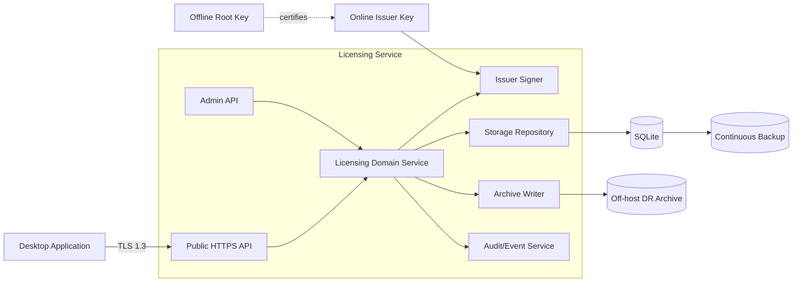

# Generic Desktop Licensing Server — Technical Design Specification

**Status:** Proposed MVP / reusable reference architecture  
**Primary implementation language:** Go  
**Default persistence:** SQLite  
**Primary licence model:** signed offline-verifiable trial and perpetual licences  
**Document date:** 2026-08-15  
**Target:** reusable licensing service for arbitrary desktop applications

## Implementation Completeness Annotation

**Assessment date:** 2026-08-23  
**Assessment scope:** the implementation in this repository, measured against each numbered section below.

| Measure | Complete | Partial | Not done | Total |
|:---|---:|---:|---:|---:|
| Numbered specification sections | 63 | 24 | 1 | 88 |
| MVP acceptance criteria | 34 | 3 | 0 | 37 |

The strict MVP acceptance completion rate is **34 of 37 (92%)**. Partial items are not counted as complete.

Status meanings:

- **Complete** — the section's material implementation requirements are present and verified.
- **Partial** — a useful implementation exists, but one or more material requirements or verification steps are missing.
- **Not done** — no substantive implementation exists yet. Sections describing explicitly future functionality use this status without implying that the functionality belongs in the first release.

The section-level assessment is intentionally stricter than “code exists.” For example, an automated restore test using a Litestream-compatible simulator does not count as a completed credentialed restore drill against the production S3/KMS destination.

| Section | Status | Implementation note |
|---:|:---|:---|
| 1. Executive Summary | **Partial** | Core issuance, persistence, continuous encrypted S3 backup and safe PITR exist; parts of the broader recovery/admin surface remain incomplete. |
| 2. Design Principles | **Partial** | Offline ownership, key separation, repository boundaries, encrypted continuous replication and simple deployment are implemented; a credentialed production restore drill remains operational work. |
| 3. Goals | **Partial** | Core licence, issuer rotation/recovery, backup and administration goals are implemented; payment integration, production DR exercises and several broader operational goals remain incomplete. |
| 4. Non-Goals for MVP | **Complete** | The implementation avoids billing, CRM, invasive DRM, always-online validation and other listed non-goals. |
| 5. Recommended Technology | **Complete** | Implemented in Go using the standard cryptographic and HTTP libraries where practical. |
| 6. High-Level Architecture | **Partial** | All shown boundaries plus PostgreSQL, AWS KMS signing and immutable S3 archive adapters exist; a separately deployed external audit sink and non-AWS cloud adapters remain outside the current architecture. |
| 7. Component Model | **Complete** | Public/admin APIs and database-neutral domain interfaces are backed by local/AWS-KMS Ed25519 signers, SQLite/PostgreSQL repositories, filesystem/S3 Object Lock archives and encrypted continuous SQLite backup. |
| 8. Cryptographic Licence Model | **Complete** | Ed25519 root-certified issuers, exact-byte envelopes, offline verification, product/time checks and test coverage are implemented. |
| 9. Trial Model | **Complete** | Configured-duration trials, HMAC subject hashes, offline artefacts, replay-safe expiry and public issuance are implemented. |
| 10. Paid Licence Issuance | **Complete** | Administrative issuance, transaction-before-response semantics and purchase-reference idempotency are implemented; payment adapters remain future work as specified. |
| 11. Activation Codes | **Complete** | High-entropy codes use versioned HMAC lookup with legacy compatibility; durable privacy-preserving installation grants, globally idempotent retries, exact capacity, expiry and code/record revocation are implemented. |
| 12. Database Strategy | **Complete** | SQLite is hidden behind repository interfaces and configured for WAL/FULL durability; PostgreSQL remains an optional future adapter. |
| 13. Initial Schema | **Complete** | Versioned migrations persist product, licence, trial, activation, revocation, issuer/root-key, root-transition, audit, retention-policy, legal-hold, export-proof and digest-only suppression state with required indexes. |
| 14. Transaction Boundaries | **Complete** | Licence, audit and outbox records commit atomically, and archive I/O happens after the database transaction. |
| 15. Disaster Recovery Architecture | **Partial** | Physical/logical backups, encrypted continuous S3 replication, immutable events, safe restore/rebuild and deletion suppression exist; the archive's independent object storage still depends on deployment. |
| 16. Continuous SQLite Backup | **Complete** | licd manages Litestream v0.5.12+, generates SSE-KMS/SSE-C S3 configuration, checks local/remote TXIDs, validates replica continuity and supports latest/PITR restore. |
| 17. Immutable Paid-Licence Archive | **Partial** | Deterministic filesystem and SSE-KMS/Object-Lock S3 events with conditional immutable writes and strict acknowledgement exist; production bucket policy/versioning validation remains deployment work. |
| 18. Archive Outbox Pattern | **Complete** | Transactional outbox, idempotent delivery, retry worker and archived-at acknowledgement are implemented. |
| 19. Logical Backup Export | **Complete** | Logical exports contain manifests, public signing-key metadata, separate activation code/record NDJSON, optional audit data and checksums; exclusive `.tar.gz` compression and conditional no-overwrite, checksummed SSE-KMS S3 upload/listing are implemented. |
| 20. Database Rebuild | **Complete** | Filesystem or credential-chain S3 archive events are replayed deterministically into a new database with ordered multi-root transition verification, inferred product records, paid-licence references/artefacts, revocations and digest-only deletion suppressions, followed by integrity checks and a structured report. |
| 21. Signing-Key Disaster Recovery | **Partial** | Lost/compromised shutdown and offline-root-certified recovery, persisted public metadata, fail-closed readiness and a custody runbook are implemented; real custody ceremonies and client distribution of compromise information remain operational work. |
| 22. Recovery Objectives | **Partial** | Versioned reports can measure remote recovery-point RPO, end-to-end RTO, strict paid-record loss and OS-service restart against enforced policies with alerts; the first actual credentialed measurement and annual offline-root custody drill remain operational evidence. |
| 23. Restore Runbook | **Partial** | Automated simulation and credentialed S3/KMS drills restore physical state, replay deletion suppressions, rebuild the immutable archive, verify schema/integrity/audit/licences/checksums and persist evidence; executing and reviewing the first drill against the deployment's actual credentials remains operational acceptance. |
| 24. Database Integrity Verification | **Complete** | Quick/deep SQLite integrity checks, foreign-key checks and staged restore verification are implemented and tested. |
| 25. Communications Security | **Complete** | Direct public traffic is TLS-1.3-only, trusted-proxy termination is allowlisted and HTTPS-asserted, and remote admin requires verified mTLS. |
| 26. Storage Security | **Partial** | Issuer paths are confined, private keys remain outside SQLite, activation/client identifiers use domain-separated HMACs, Unix private-file modes and managed Windows ACLs are enforced, and S3 encryption is mandatory; primary database encryption remains a deployment concern. |
| 27. Secret Management | **Partial** | Secrets are external files/environment/AWS credential-chain references, issuer paths are confined, root trust is checked and AWS KMS signing is supported; generic OS secret-store and non-AWS HSM providers remain absent. |
| 28. API Security | **Complete** | Exact-one-value strict JSON, body/header bounds, server timeouts, generic errors, request IDs, separated listeners, hardened trusted-proxy client identity, OS/mTLS RBAC and fail-closed persistent abuse protection are implemented and tested. |
| 29. Rate Limiting | **Complete** | Configured SQLite-backed fixed-window limits coordinate processes and survive restart across trial IP/subject/product, activation IP/code and signed-status/service-info IP dimensions; keyed digests prevent raw IP/subject retention. |
| 30. Audit Logging | **Complete** | Atomic product, issuer/root, retention-policy, legal-hold and deletion lifecycle events, every authenticated admin request/read, security failures, archive work, exports, backup/restore/database operations and recovery-drill attempts/results are recorded with actors, request IDs, results/reasons and secret-free metadata. |
| 31. Tamper-Evident Audit Chain | **Complete** | SHA-256 previous-event chaining and full-chain verification are implemented. |
| 32. Logging | **Complete** | Structured JSON/text logs include service/version, event, operation, result, status, reason, request, actor, duration and byte fields; secrets/bodies are excluded or redacted, operational coverage is broad, and file rotation/age/count retention is bounded. |
| 33. Public HTTP API | **Complete** | Trial, idempotent activation, service-info and signed short-lived licence-status endpoints are implemented with rate limiting, nonce binding and root-verifiable issuer certificates. |
| 34. Error Model | **Complete** | All handler, authentication, rate-limit, oversized-body, unknown-route and wrong-method failures use stable JSON envelopes; resource/state-specific and root-transition v1 codes and HTTP statuses are implemented, tested and catalogued. |
| 35. CLI Requirements | **Complete** | Separate `licd`/`licctl` binaries and global machine-readable JSON output are implemented. |
| 36. CLI Command Structure | **Complete** | Every specified command plus root lifecycle, issuer recovery, restore points, recovery-drill run/status/list/show with optional native-service restart evidence, safe production export, retention, deletion, legal holds and suppression inspection is implemented with machine-readable output. |
| 37. Useful CLI Examples | **Partial** | Issuance, activation retry/revocation, inspection, verification, export and rebuild flows are documented and work; some flags/destinations still differ from illustrative examples. |
| 38. Administration Authentication | **Complete** | Unix socket modes and Windows pipe SDDL protect local administration; remote mTLS identities map to viewer/operator/revoker/admin roles. |
| 39. Configuration | **Partial** | Cobra/Viper validates transport, mTLS, root trust/protected issuer paths, PostgreSQL TLS/pools, AWS KMS, immutable archive S3, recovery-drill schedule/objectives/storage/proxy/resource policies, log retention, distinct secret material and backup timing; hot reload and generic secret-manager providers remain absent. |
| 40. Filesystem Layout | **Complete** | Configuration-derived layout init/check manages config, secret, TLS, database, archive, backup, restore, log and runtime locations; packages set Linux ownership/modes and Windows uses protected SID-based ACLs. |
| 41. Restart Behaviour | **Complete** | Durable activation idempotency, active-issuer restoration, migrations, outbox replay, archived deletion-suppression reconciliation and native service restart support are implemented; missing authority or suppression archive access fails closed. |
| 42. Graceful Shutdown | **Complete** | Signal handling, bounded HTTP shutdown, worker cancellation and Litestream final sync are implemented, including a Windows one-shot final sync fallback. |
| 43. Health Checks | **Complete** | Liveness exposes a per-process boot identity; readiness gates database/schema, signer/root, strict archive and required backup health and reports recovery-drill freshness as a warning or configured required blocker. |
| 44. Metrics | **Complete** | Bounded Prometheus telemetry covers HTTP/domain/database/archive/signer/backup state plus recovery-drill runs, failures, running/overdue state, last success, measured RPO/RTO and objective outcome without sensitive or high-cardinality labels. |
| 45. Database Migration | **Complete** | Named ordered migrations carry additive/destructive classifications, run transactionally, reject non-contiguous/newer schemas, receive post-migration verification, and destructive work is prohibited at startup and restricted to the explicit CLI path. |
| 46. Backup Before Migration | **Complete** | Successful deep backup verification records an atomic chained-audit evidence row with path, size, SHA-256 and time; destructive migration rechecks the unchanged file and configured age limit unless `--force-without-backup` is explicit and audited. |
| 47. Concurrency | **Complete** | Short SQLite transactions, serialized/guarded activation capacity, uniqueness constraints, bounded connections, busy timeout and post-commit external I/O follow the specified model. |
| 48. Time Handling | **Complete** | Issuance, activation and persistence use UTC/RFC3339 and licence/code expiry ends exactly at the boundary. |
| 49. Identifiers | **Complete** | Prefixed UUIDv7 identifiers are used rather than sequential public IDs. |
| 50. Product Model | **Complete** | Multiple products support atomic audited create/update/list/show operations, and all licence issuance, verification and status statements remain bound to an explicit product ID. |
| 51. Entitlement Model | **Complete** | Generic signed entitlement names and wildcard trials are implemented. |
| 52. Version Entitlement | **Complete** | Maximum major version and maintenance date are signed without hard-coding client commercial policy. |
| 53. Licence Artefact Storage | **Complete** | Exact artefact, payload hash, issuer ID and metadata are stored and idempotently redelivered. |
| 54. Reissue | **Complete** | An explicit reasoned API/CLI operation creates a distinct newly signed artefact and atomic `licence.reissued` audit event without mutating the original licence. |
| 55. Threat Model | **Partial** | Core forgery, tampering, SQL/path, archive and trial threats are addressed; host/key theft and administrative compromise controls are incomplete. |
| 56. Security Boundary | **Partial** | Root/private-key/database boundaries, AWS KMS signing and OS/mTLS administration controls are enforced, but generic HSM/OS-keystore signing and finer local identity attribution remain incomplete. |
| 57. Supply-Chain Security | **Complete** | CI runs race tests, vet, reachable Go and container vulnerability scans; GoReleaser emits checksums and per-artifact SPDX SBOMs; tagged releases receive keyless Cosign signatures plus GitHub provenance attestations, including the container digest. |
| 58. Go Package Layout | **Complete** | The repository is separated into command, API, domain, format, signer, issuer/root-lifecycle, storage, archive, recovery and configuration packages, plus dependency-isolated public client-verifier and data-export-schema packages. |
| 59. Dependencies | **Complete** | The standard library is preferred; external dependencies are confined to Cobra/Viper, SQLite, pgx, AWS SDK v2, UUID and native service management for implemented adapters. |
| 60. SQLite Driver Choice | **Complete** | A maintained pure-Go driver supports static cross-compilation, WAL, busy timeout, contexts and backups. |
| 61. Server Resource Target | **Partial** | Recovery drills enforce configurable process-memory, goroutine and temporary-storage budgets and report measured values; representative CPU/load benchmarking is still required. |
| 62. Deployment Model | **Complete** | Bare-host binaries, Windows services, systemd/Linux packages and a hardened non-root read-only container/Compose deployment with persistent data, mounted secrets, health checking, multi-architecture GHCR publishing, SBOM and provenance are implemented. |
| 63. Reverse Proxy | **Partial** | Trusted-header policy is implemented and scheduled/manual acceptance can probe the configured production HTTPS origin for routing, HSTS and service-info; provider-specific proxy deployment templates and load tests remain external. |
| 64. Payment Webhook Security | **Not done** | No payment-provider webhook adapter or signature/replay verification exists. |
| 65. Backup Verification Schedule | **Complete** | A single-flight scheduler runs simulation or credentialed full restores at the configured interval, atomically retains versioned reports, prunes them by policy and exposes failures/objective misses/overdue state through reports, audit, metrics and readiness. |
| 66. Reconciliation | **Complete** | `archive reconcile --deep` reports paid-licence/event totals, both missing directions, payload-hash and revocation mismatches in JSON; `--repair` only queues audited, deterministic DB-authoritative missing archive events and never overwrites immutable conflicts or mutates missing DB records. |
| 67. Read-Only Recovery Mode | **Complete** | Configuration can reject all mutations while retaining inspection and health endpoints. |
| 68. Maintenance Mode | **Complete** | Admin-only status/enable/disable controls persist a reasoned maintenance lifecycle with atomic audit events; mutation endpoints return stable 503/`Retry-After`, readiness drains traffic, and background archive mutation pauses while inspection remains available. |
| 69. Key Rotation Procedure | **Complete** | Root-authenticated issuer metadata is persisted; staged activation and one-step atomic rotation retire the former issuer, preserve old artefact validity, survive restart, emit audit events and are acceptance-tested. |
| 70. Root Rotation | **Complete** | Dual-signed, domain-separated root-transition artefacts, bounded overlap/cutover policy, persisted public keyring metadata, audited activate/retire/rollback/compromise lifecycles, fail-closed signing, offline/admin CLI tooling, recovery procedures and deterministic cross-language vectors are implemented. |
| 71. Licence Format Test Vectors | **Complete** | Versioned deterministic vectors publish exact JSON/base64url/signing inputs for valid, invalid-signature, expiry, wrong-product and signed outside-authority LIC1 cases plus valid, expired, wrong-nonce/product and invalid-signature status statements; both server and public-client suites execute them. |
| 72. Testing Strategy | **Complete** | Unit/integration/race suites include strict-input, format/archive fuzzing, corruption, write locks, simulated S3, restore/rebuild, issuer loss/expiry, security controls, isolated recovery drills, suppression replay, persisted reports, resource failure and overdue readiness. Credentialed production S3/KMS execution remains section 23 operational acceptance. |
| 73. Critical Failure-Window Tests | **Complete** | Context-only deterministic failpoints cover before/during transaction, immediately after commit, during/after archive upload and after response; every case proves one idempotent licence, retryable archive delivery, zero final backlog and one immutable event. |
| 74. Clock and Expiry Tests | **Complete** | UTC/New York/Dublin/Tokyo, DST transition, leap-day, exact nanosecond expiry, issuer window, activation boundary, backward/forward clocks and signed-status skew/validity boundaries are covered. |
| 75. Operational CLI Safety | **Complete** | Key/output overwrite refusal, mandatory licence/activation lifecycle reasons, exact-ID key confirmation, explicit no-active retirement and non-disclosure of private/code material are implemented. |
| 76. Configuration Validation | **Partial** | Core values, managed filesystem layout/ACLs, protected issuer directory, configured-root certificate trust, key/certificate match, TLS material, admin exposure, S3 URL/encryption and Litestream version are validated; archive/S3 reachability is runtime-checked rather than preflighted. |
| 77. Build-Time Client Integration | **Complete** | The standard-library-only public `client/verifier` v1 API verifies LIC1, ISC1, signed status and RKT1, manages an embedded-root keyring atomically, exposes stable typed UX errors and injected time, consumes both published vector files, and includes Windows/Linux/Raspberry Pi integrations and a semantic-version contract. |
| 78. Privacy | **Complete** | Core operation uses opaque references plus HMAC trial, installation and request identities without requiring direct identity data; public exports omit secrets/HMACs, and deletion tombstones retain only domain-separated digests and bounded lifecycle metadata. |
| 79. Data Retention | **Complete** | Versioned category policies, dry-run plans, exact scopes, legal holds, optional verified-export gates, transactional SQLite/PostgreSQL deletion, immutable exceptions, audited lifecycle, digest-only tombstones and archive-backed rebuild/PITR/startup suppression are implemented and documented. |
| 80. Data Export | **Complete** | Versioned database-independent public schemas, deterministic checksummed NDJSON, product/licence/customer/status/time filters, secret-free licence/activation/revocation/audit projections, admin-only audited API access, safe exclusive CLI output, SQLite/PostgreSQL round-trip contracts and privacy/versioning documentation are implemented. |
| 81. Suggested MVP Phases | **Partial** | Phases 1–3 and issuer/backup portions of phase 4 are implemented; production DR drills, payment adapters and alternative persistence remain incomplete. |
| 82. MVP Acceptance Criteria | **Partial** | The item-level assessment in this section identifies the remaining release blockers. |
| 83. Engineering Decisions and Critique | **Complete** | The implementation follows SQLite-first, WAL/FULL, offline signatures, offline root, outbox and non-invasive trial decisions. |
| 84. Potential Pitfalls | **Partial** | Activation retry/concurrency, transport/admin security, encrypted backups and issuer lifecycle are addressed; real-destination restore drills and remaining operational gaps still need work. |
| 85. Recommended Initial Production Profile | **Partial** | Go/SQLite/Ed25519 lifecycle management, TLS enforcement and encrypted Litestream S3 DR exist; immutable archive-S3 and a measured production restore drill remain. |
| 86. State-of-the-Art Upgrade Path | **Partial** | PostgreSQL persistence and AWS KMS signing are implemented; managed HA, redundant APIs, cross-region archive replication, enterprise identity, payment webhooks, non-AWS HSMs and an external transparency log remain optional future upgrades. |
| 87. References and Verification Notes | **Complete** | The implementation uses the referenced Go cryptography, TLS and SQLite foundations; operational third-party integrations remain separately assessed above. |
| 88. Final Recommendation | **Partial** | Offline-verifiable ownership, secure transport and continuous encrypted recovery are implemented; production S3/KMS and full archive restore drills remain deployment acceptance work. |

---

## 1. Executive Summary

This specification defines a small, secure, recoverable licensing server that can be reused across multiple desktop applications.

The service is intentionally designed to avoid becoming a heavyweight SaaS platform. Its main responsibilities are:

1. issue 30-day trial licences;
2. issue perpetual or other licence types after purchase;
3. optionally redeem human-friendly activation codes;
4. maintain an auditable record of licence issuance, revocation and activation;
5. produce licence artefacts that desktop applications can validate **offline**;
6. support key rotation without invalidating previously issued perpetual licences;
7. persist all operational state;
8. continuously back up operational data off-host;
9. separately archive paid licence issuance records so the database can be rebuilt after disaster;
10. expose a useful administrative command line;
11. restart safely after process, host or power failure;
12. support alternative database engines without changing the licensing domain model.

The recommended first implementation is a **single Go service + SQLite database + off-host object storage**.

The database is *not* the cryptographic authority for an already-issued licence. The licence artefact is digitally signed and remains independently verifiable. This is important: loss of the licensing server must never make a customer's legitimately purchased perpetual licence invalid.

A recommended production deployment is:

```text
Desktop Apps
     |
     | HTTPS / TLS
     v
+----------------------------+
| Licensing Service          |
|                            |
| Public API                 |
| Admin API / local socket   |
| Licence issuer             |
| Trial policy               |
| Audit/event writer         |
| Archive writer             |
+-------------+--------------+
              |
      +-------+-------+
      |               |
      v               v
   SQLite          DR Archive
 local disk       S3-compatible
      |           object store
      |
      v
 Litestream
 continuous replica
      |
      v
 off-host storage
```

The MVP should remain small enough to run comfortably on a low-cost VM, small VPS, Raspberry Pi-class system, or conventional application server.

---

## 2. Design Principles

### 2.1 Ownership first

A perpetual desktop licence must not require the licensing server to remain online.

Once issued, a perpetual licence should be verifiable locally by the desktop application.

### 2.2 Server loss must not invalidate customers

The desktop application verifies a cryptographic signature rather than querying the server for truth on every startup.

### 2.3 No secret signing material in desktop applications

Desktop applications contain only public verification keys.

Private signing keys remain server-side or offline.

### 2.4 The database is replaceable

Business logic must depend on repository interfaces rather than SQLite-specific SQL.

SQLite is the initial persistence implementation, not the domain architecture.

### 2.5 Paid licence issuance is financially significant

A successful paid licence issuance must be durable.

The default production profile should prefer durability over maximum write throughput.

### 2.6 Minimise personally identifiable information

The licensing service should not become a customer CRM.

Store opaque customer and purchase references whenever possible.

### 2.7 Simple deployment

The target operational model is:

```text
one binary
one configuration file
one local database
one data directory
one off-host backup destination
```

### 2.8 Recoverability is a product requirement

Backup, restore, verification and database reconstruction are first-class commands, not operational afterthoughts.

---

## 3. Goals

The system SHALL support:

- 30-day trial licences;
- perpetual licences;
- future licence types without schema redesign;
- multiple products;
- product/version entitlement constraints;
- feature entitlements;
- signed offline-verifiable licences;
- reusable desktop-app integration;
- optional activation-code redemption;
- licence revocation records;
- idempotent issuance;
- audit events;
- persistent storage;
- application restart and host restart;
- database migration;
- continuous off-host backup;
- independent paid-licence archive;
- point-in-time recovery where supported;
- database reconstruction from archived events;
- signing-key rotation;
- secure public communications;
- strongly protected administration;
- low idle RAM and CPU consumption;
- machine-readable CLI output;
- Linux, Windows and container deployment.

---

## 4. Non-Goals for MVP

The initial implementation SHOULD NOT attempt to provide:

- a full billing system;
- credit-card processing;
- a CRM;
- tax/VAT calculation;
- software update distribution;
- complex enterprise seat metering;
- floating network licences;
- always-online DRM;
- kernel-level anti-tampering;
- hardware dongles;
- invasive device fingerprinting;
- globally distributed active-active databases;
- Kubernetes as a deployment requirement;
- a customer-facing web portal.

Payment processors may integrate later through a small adapter or webhook interface.

The core licensing service should store an opaque `purchase_ref` rather than payment card details.

---

## 5. Recommended Technology

## 5.1 Language: Go

Go is the preferred implementation language.

Reasons:

- excellent standard HTTP/TLS stack;
- Ed25519 is available in the standard library;
- good SQLite and PostgreSQL ecosystem;
- simple concurrency model;
- straightforward cross-compilation;
- suitable for long-running services;
- low operational footprint;
- easy production of a single executable;
- strong fit for CLI + server in one repository;
- built-in fuzzing and race detection;
- convenient structured logging with `log/slog`.

At the time of this specification, Go 1.26 is the current stable major release. The implementation SHOULD build against the current supported stable Go release rather than permanently pinning to 1.26.

### Alternatives

**Rust** would also be a technically strong choice and can provide tighter memory-safety guarantees at the language level. It is not preferable here unless the implementation team is already more productive in Rust. The licensing workload is operationally simple and Go's networking, deployment and maintenance advantages outweigh Rust's additional implementation complexity for this service.

**Java/Kotlin** are viable but add runtime footprint and deployment complexity without providing a material advantage for this small service.

**Node.js/Python** can implement the service, but a compiled Go service has a better default deployment and dependency profile for a small security-sensitive daemon.

**Decision:** use Go.

---

## 6. High-Level Architecture



---

## 7. Component Model

**Implementation status: Complete.** The database-neutral domain interfaces are wired to SQLite and PostgreSQL repositories; the signer lifecycle supports protected local Ed25519 keys and AWS KMS `ECC_NIST_EDWARDS25519`; and the archive boundary supports durable filesystem events plus conditional, checksummed, SSE-KMS-encrypted S3 writes with Object Lock. Adapter selection and safety requirements are validated by configuration, and repository/KMS/S3 contract tests cover wire-compatible behavior.

### 7.1 Public API

Responsibilities:

- trial issuance;
- activation-code redemption;
- optional licence status checks;
- client-compatible version discovery if required;
- health endpoint only if intended for public load-balancer use.

The Public API MUST NOT expose administrative licence creation.

### 7.2 Admin API

Responsibilities:

- product administration;
- paid licence issuance;
- licence inspection;
- revocation;
- archive operations;
- backup coordination;
- operational status;
- key metadata inspection.

The Admin API SHOULD bind only to:

- loopback;
- Unix domain socket;
- Windows named pipe;
- private management network;

unless explicitly configured otherwise.

Remote administration SHOULD use mutual TLS.

### 7.3 Licensing Domain Service

Contains the business rules.

It MUST NOT contain database-specific logic.

Typical methods:

```go
type Service interface {
    IssueTrial(ctx context.Context, req IssueTrialRequest) (*IssuedLicence, error)
    IssueLicence(ctx context.Context, req IssueLicenceRequest) (*IssuedLicence, error)
    RedeemActivation(ctx context.Context, req RedeemRequest) (*IssuedLicence, error)
    RevokeLicence(ctx context.Context, req RevokeRequest) error
    GetLicence(ctx context.Context, id string) (*LicenceRecord, error)
}
```

### 7.4 Signer

Abstracts private-key operations:

```go
type Signer interface {
    KeyID() string
    Algorithm() string
    Sign(ctx context.Context, message []byte) ([]byte, error)
    PublicKey(ctx context.Context) ([]byte, error)
}
```

Possible implementations:

- protected local Ed25519 key;
- OS secret store;
- HSM;
- cloud KMS where a compatible signature algorithm is available;
- remote signing service.

### 7.5 Storage Repository

Example interface:

```go
type Repository interface {
    WithTx(ctx context.Context, fn func(TxRepository) error) error

    GetProduct(ctx context.Context, productID string) (*Product, error)
    GetLicence(ctx context.Context, licenceID string) (*LicenceRecord, error)
    FindByPurchaseRef(ctx context.Context, productID, purchaseRef string) (*LicenceRecord, error)

    CreateLicence(ctx context.Context, rec LicenceRecord) error
    CreateTrial(ctx context.Context, rec TrialRecord) error
    CreateActivation(ctx context.Context, rec ActivationRecord) error
    CreateRevocation(ctx context.Context, rec RevocationRecord) error
    AppendAuditEvent(ctx context.Context, event AuditEvent) error
}
```

Adapters:

```text
internal/storage/sqlite
internal/storage/postgres
```

The domain service SHOULD NOT import either adapter.

### 7.6 Archive Store

An independent disaster-recovery interface:

```go
type ArchiveStore interface {
    PutEvent(ctx context.Context, event ArchiveEvent) error
    GetEvent(ctx context.Context, eventID string) (*ArchiveEvent, error)
    ListEvents(ctx context.Context, cursor string) ([]ArchiveEvent, string, error)
}
```

Initial implementations:

- local filesystem;
- S3-compatible object storage.

Future implementations may support Azure Blob or Google Cloud Storage.

---

## 8. Cryptographic Licence Model

## 8.1 Why signed licences

A signed licence lets the desktop application answer:

> Was this licence created by an authorised issuer and has the licence payload been altered?

without contacting the licensing server.

The desktop application has verification material only.

It MUST NOT contain a private key or shared HMAC secret used to manufacture licences.

---

## 8.2 Algorithm

Default:

```text
Ed25519
```

Go implementation:

```go
crypto/ed25519
```

Ed25519 is specified by RFC 8032 and implemented by Go's standard library.

Do not invent a custom signature algorithm.

---

## 8.3 Recommended key hierarchy

Use two levels:

```text
Offline Root Key
      |
      | signs issuer certificate
      v
Online Issuer Key
      |
      | signs licences
      v
Licence Artefacts
```

### Root private key

- generated offline;
- never stored on the licensing server;
- backed up in at least two separately protected locations;
- used only to certify or replace issuer public keys.

### Root public key

Embedded in each desktop application.

### Issuer private key

Available to the licensing server.

Used for normal licence issuance.

### Issuer certificate

A small signed document containing:

```json
{
  "schema_version": 1,
  "issuer_key_id": "issuer-2026-01",
  "algorithm": "Ed25519",
  "public_key": "<base64url>",
  "authority_not_before": "2026-08-01T00:00:00Z",
  "authority_not_after": "2027-08-01T00:00:00Z",
  "products": ["*"]
}
```

The root key signs this document.

Important semantic rule:

> `authority_not_after` limits when the issuer was authorised to **issue** licences. It does not make perpetual licences stop working after that date.

The desktop validator checks that the licence's `issued_at` occurred inside the issuer authority period.

This avoids accidentally turning issuer-key rotation into licence expiration.

---

## 8.4 Licence envelope

Avoid requiring clients in different languages to reproduce JSON canonicalisation.

Recommended format:

```text
LIC1.<issuer-key-id>.<base64url-payload>.<base64url-signature>
```

The signature input MUST be precisely specified, for example:

```text
"desktop-licence:v1\n" +
issuerKeyID +
"\n" +
base64urlPayload
```

The payload is serialized once by the issuer.

The client verifies the signature over the exact encoded payload before parsing the JSON.

This avoids signing one JSON representation and verifying a semantically equivalent but byte-different representation.

---

## 8.5 Licence payload

Example:

```json
{
  "schema_version": 1,
  "licence_id": "lic_01JXYZ...",
  "product_id": "com.example.product",
  "licence_type": "perpetual",
  "subject_ref": "cust_01J...",
  "issued_at": "2026-08-15T06:30:00Z",
  "not_before": "2026-08-15T06:30:00Z",
  "expires_at": null,
  "max_major_version": 1,
  "maintenance_until": null,
  "seat_model": "named_user",
  "seat_count": 1,
  "entitlements": [
    "core",
    "scheduling",
    "remote_execution"
  ],
  "metadata": {
    "display_name": "Example Customer"
  }
}
```

### Trial example

```json
{
  "schema_version": 1,
  "licence_id": "trl_01JXYZ...",
  "product_id": "com.example.product",
  "licence_type": "trial",
  "subject_ref": "trial_4A1...",
  "issued_at": "2026-08-15T06:30:00Z",
  "not_before": "2026-08-15T06:30:00Z",
  "expires_at": "2026-09-14T06:30:00Z",
  "entitlements": ["*"]
}
```

### Privacy recommendation

Do not put an email address into the signed artefact unless the product genuinely needs to display it.

Prefer an opaque `subject_ref`.

---

## 8.6 Desktop verification algorithm

The client MUST:

1. parse the `LIC1` envelope;
2. obtain the issuer certificate included with or known by the licence artefact;
3. verify the issuer certificate using the embedded root public key;
4. verify that `licence.issued_at` falls inside the issuer's authority period;
5. verify the licence signature using the issuer public key;
6. parse the payload only after signature verification;
7. confirm `product_id`;
8. enforce `not_before`;
9. enforce `expires_at` when present;
10. enforce product-version limits;
11. enforce relevant entitlements.

Pseudocode:

```go
func VerifyLicence(root ed25519.PublicKey, artifact Artifact, now time.Time) error {
    if err := VerifyIssuerCertificate(root, artifact.IssuerCertificate); err != nil {
        return err
    }

    issuer := artifact.IssuerCertificate

    if !VerifyIssuerSignature(issuer.PublicKey, artifact.Envelope) {
        return ErrInvalidSignature
    }

    payload := ParseVerifiedPayload(artifact.Envelope)

    if payload.IssuedAt.Before(issuer.AuthorityNotBefore) ||
       payload.IssuedAt.After(issuer.AuthorityNotAfter) {
        return ErrIssuerNotAuthorisedAtIssueTime
    }

    if payload.ExpiresAt != nil && !now.Before(*payload.ExpiresAt) {
        return ErrExpired
    }

    return nil
}
```

---

## 8.7 Revocation and offline licences

There is an unavoidable trade-off:

> a fully offline perpetual licence cannot immediately learn that the server has revoked it.

The MVP SHOULD treat revocation as:

- enforced during future online activation;
- enforced during optional status checks;
- available to later app releases through a signed revocation list;
- not a reason to require permanent Internet access.

Chargebacks or fraud may therefore prevent future activation or updates while an already-issued fully offline artefact can remain technically usable.

This is preferable to making a perpetual licence dependent on the vendor's continued operation.

---

## 9. Trial Model

## 9.1 Default duration

Default:

```text
30 * 24 hours
```

The server calculates expiry using UTC.

Example:

```text
issued_at  = 2026-08-15T06:30:00Z
expires_at = 2026-09-14T06:30:00Z
```

Do not base validity on "29 more local calendar dates".

---

## 9.2 Trial identity

The default privacy-preserving MVP identity SHOULD be a random installation identifier generated by the desktop app.

Example:

```text
install_id = 128-bit cryptographically random value
```

The server SHOULD store:

```text
HMAC-SHA256(trial_pepper, product_id || install_id)
```

rather than storing the raw value where possible.

This prevents the database from containing a directly reusable identifier.

### Limitation

If the user completely removes the app and generates a new installation ID, they can obtain another trial.

That is acceptable for the default MVP.

More aggressive trial enforcement can later support pluggable policies:

```text
installation_id
account_id
privacy-preserving device hash
email verification
organisation identity
```

Do not implement invasive hardware fingerprinting by default.

---

## 9.3 Trial request

```http
POST /v1/trials
Content-Type: application/json
```

```json
{
  "product_id": "com.example.product",
  "install_id": "adabf6d1-..."
}
```

Response:

```json
{
  "licence_artifact": "<signed artifact>",
  "expires_at": "2026-09-14T06:30:00Z"
}
```

Repeated requests for the same trial subject SHOULD return the original trial or an equivalent licence with the same original expiry.

A client MUST NOT be able to extend a trial merely by requesting it again.

---

## 10. Paid Licence Issuance

## 10.1 Initial MVP flow

The first release does not require payment-provider integration.

An administrator may issue a licence using the CLI:

```bash
licctl licence issue \
  --product com.example.product \
  --type perpetual \
  --customer-ref cust_12345 \
  --purchase-ref order_98765 \
  --max-major-version 1 \
  --output customer.lic
```

The service:

```text
validate request
      |
check idempotency/purchase_ref
      |
construct payload
      |
sign payload
      |
DB transaction
      |
archive paid licence off-host
      |
return licence
```

---

## 10.2 Payment-provider integration

A future payment adapter may call the same domain operation.

The licensing domain MUST NOT contain Stripe, Paddle, Lemon Squeezy or another vendor's types.

Adapter pattern:

```text
Payment webhook
      |
      v
PurchaseAdapter
      |
      v
IssueLicence()
```

Store only opaque references such as:

```text
payment_provider = "stripe"
purchase_ref     = "pi_..."
customer_ref     = "cus_..."
```

Do not store card details.

---

## 10.3 Idempotency

Paid issuance MUST be idempotent.

At minimum:

```text
UNIQUE(product_id, purchase_ref)
```

A repeated request with the same purchase reference and materially identical parameters returns the existing licence.

A repeated purchase reference with conflicting parameters returns:

```text
409 Conflict
```

External webhook integrations SHOULD additionally accept an `Idempotency-Key`.

---

## 11. Activation Codes

Activation codes are optional.

If supported, use high-entropy random opaque values.

Example human-friendly representation:

```text
ABCD7-F9K2M-XP4RT-7QCW8
```

The code itself SHOULD NOT encode the licence.

The database maps a hash of the code to:

- licence;
- redemption state;
- activation policy.

Store:

```text
HMAC-SHA256(activation_code_pepper, activation_code)
```

not the plaintext activation code.

The plaintext code is shown once to the purchaser.

### 11.1 Idempotent redemption

Each client persists a random installation ID and sends a random `Idempotency-Key` for the logical redemption attempt. Both identifiers are treated as opaque; they MUST NOT be derived from hardware serial numbers, usernames or other personal identifiers.

The server stores domain-separated HMAC references rather than either raw identifier. In one transaction it:

1. returns an existing active record when the request or code/installation pair already succeeded;
2. rejects reuse of an idempotency key with a different code, installation or metadata;
3. verifies code/licence state, expiry and remaining capacity;
4. inserts the individual activation record;
5. increments the guarded use count;
6. appends the audit event.

A retry MUST NOT consume another use. Concurrency MUST NOT permit more than `max_uses` active records.

### 11.2 Revocation semantics

Revoking an individual activation prevents its retrieval and releases one unit of code capacity. Revoking an activation code blocks new installations but does not invalidate existing activation records; revoke the record or licence when an existing installation must also stop retrieving the artefact.

An existing successful activation may be retrieved after its code later expires, becomes exhausted or is revoked. This prevents a response-loss retry from being stranded by a later policy transition.

---

## 12. Database Strategy

## 12.1 Default: SQLite

SQLite is the recommended initial database.

Reasons:

- extremely small runtime footprint;
- persistent;
- transactional;
- mature;
- no separate database daemon;
- convenient backup;
- appropriate concurrency for a licensing server;
- trivial local development;
- easy disaster recovery;
- low memory consumption.

A licence service is normally a low-write-volume workload.

MongoDB, Elasticsearch or another memory-heavy database is not justified for the MVP.

---

## 12.2 SQLite durability profile

Recommended settings:

```sql
PRAGMA journal_mode = WAL;
PRAGMA synchronous = FULL;
PRAGMA foreign_keys = ON;
PRAGMA busy_timeout = 5000;
```

Rationale:

- WAL allows concurrent readers while preserving simple single-node operation.
- `synchronous=FULL` adds a WAL sync at transaction commit and is the appropriate default when an acknowledged licence sale should survive power failure.
- foreign-key enforcement must explicitly be enabled for each connection/adapter configuration.
- a busy timeout reduces transient lock failures.

The SQLite adapter MUST ensure connection-level pragmas are applied reliably for every connection where required.

Database files MUST be kept on a local filesystem or a storage system explicitly known to support SQLite's locking requirements.

Do not place the live SQLite database casually on SMB/NFS network shares.

---

## 12.3 Database abstraction

Do not expose `*sql.DB` outside the storage adapter.

Use domain repositories.

This avoids common pseudo-portability such as:

```text
"we use database/sql, therefore the database is pluggable"
```

while business SQL, placeholder syntax, migrations and transaction semantics remain SQLite-specific.

Actual pluggability requires adapters.

---

## 12.4 Future PostgreSQL adapter

PostgreSQL becomes attractive if the service later requires:

- multiple active server instances;
- higher sustained write concurrency;
- managed database HA;
- large organisational licensing datasets;
- sophisticated reporting;
- multi-region infrastructure.

The domain model and API should not need to change.

---

## 13. Initial Schema

Illustrative schema, not final migration SQL:

```sql
CREATE TABLE products (
    product_id              TEXT PRIMARY KEY,
    display_name            TEXT NOT NULL,
    default_trial_seconds   INTEGER NOT NULL,
    active                  INTEGER NOT NULL,
    created_at              TEXT NOT NULL
);

CREATE TABLE licences (
    licence_id              TEXT PRIMARY KEY,
    product_id              TEXT NOT NULL,
    licence_type            TEXT NOT NULL,
    customer_ref            TEXT,
    purchase_ref            TEXT,
    issuer_key_id           TEXT NOT NULL,
    issued_at               TEXT NOT NULL,
    not_before              TEXT NOT NULL,
    expires_at              TEXT,
    status                  TEXT NOT NULL,
    payload_hash            BLOB NOT NULL,
    signed_artifact         BLOB NOT NULL,
    metadata_json           TEXT,
    created_at              TEXT NOT NULL,
    FOREIGN KEY(product_id) REFERENCES products(product_id)
);

CREATE UNIQUE INDEX licences_purchase_ref_uq
ON licences(product_id, purchase_ref)
WHERE purchase_ref IS NOT NULL;

CREATE TABLE trials (
    trial_id                TEXT PRIMARY KEY,
    product_id              TEXT NOT NULL,
    subject_hash            BLOB NOT NULL,
    licence_id              TEXT NOT NULL,
    started_at              TEXT NOT NULL,
    expires_at              TEXT NOT NULL,
    created_at              TEXT NOT NULL,
    FOREIGN KEY(product_id) REFERENCES products(product_id),
    FOREIGN KEY(licence_id) REFERENCES licences(licence_id)
);

CREATE UNIQUE INDEX trials_subject_uq
ON trials(product_id, subject_hash);

CREATE TABLE activation_codes (
    activation_code_id      TEXT PRIMARY KEY,
    code_hash               BLOB NOT NULL UNIQUE,
    hash_version            TEXT NOT NULL,
    licence_id              TEXT NOT NULL,
    max_uses                INTEGER NOT NULL,
    use_count               INTEGER NOT NULL,
    expires_at              TEXT,
    revoked_at              TEXT,
    revocation_reason       TEXT,
    created_at              TEXT NOT NULL,
    FOREIGN KEY(licence_id) REFERENCES licences(licence_id)
);

CREATE TABLE activations (
    activation_id           TEXT PRIMARY KEY,
    activation_code_id      TEXT NOT NULL,
    licence_id              TEXT NOT NULL,
    instance_ref_hash       BLOB NOT NULL,
    request_ref_hash        BLOB NOT NULL UNIQUE,
    activated_at            TEXT NOT NULL,
    last_retrieved_at       TEXT NOT NULL,
    revoked_at              TEXT,
    revocation_reason       TEXT,
    metadata_json           TEXT,
    FOREIGN KEY(activation_code_id) REFERENCES activation_codes(activation_code_id),
    FOREIGN KEY(licence_id) REFERENCES licences(licence_id)
);

CREATE UNIQUE INDEX activations_instance_uq
ON activations(activation_code_id, instance_ref_hash);

CREATE TABLE revocations (
    revocation_id           TEXT PRIMARY KEY,
    licence_id              TEXT NOT NULL,
    reason_code             TEXT NOT NULL,
    reason_text             TEXT,
    revoked_at              TEXT NOT NULL,
    FOREIGN KEY(licence_id) REFERENCES licences(licence_id)
);

CREATE TABLE signing_keys (
    issuer_key_id           TEXT PRIMARY KEY,
    algorithm               TEXT NOT NULL,
    public_key              BLOB NOT NULL,
    issuer_certificate      BLOB NOT NULL,
    authority_not_before    TEXT NOT NULL,
    authority_not_after     TEXT NOT NULL,
    status                  TEXT NOT NULL
);

CREATE TABLE audit_events (
    event_id                TEXT PRIMARY KEY,
    occurred_at             TEXT NOT NULL,
    actor_type              TEXT NOT NULL,
    actor_ref               TEXT,
    event_type              TEXT NOT NULL,
    aggregate_type          TEXT,
    aggregate_id            TEXT,
    request_id              TEXT,
    event_json              TEXT NOT NULL,
    previous_event_hash     BLOB,
    event_hash              BLOB NOT NULL
);

CREATE TABLE archive_outbox (
    event_id                TEXT PRIMARY KEY,
    event_type              TEXT NOT NULL,
    event_json              TEXT NOT NULL,
    created_at              TEXT NOT NULL,
    archived_at             TEXT
);

CREATE TABLE schema_migrations (
    version                 INTEGER PRIMARY KEY,
    applied_at              TEXT NOT NULL
);
```

### Private keys are deliberately absent

The database MUST NOT contain the root private key.

Prefer not to store the online issuer private key in the database either.

---

## 14. Transaction Boundaries

Licence issuance should be atomic inside the operational database.

Example:

```text
BEGIN

  insert licence
  insert audit event
  insert archive outbox event

COMMIT
```

Only after a successful commit may the service proceed to the external archive step.

For paid licences, production may use strict archive acknowledgement as described below.

---

## 15. Disaster Recovery Architecture

Database backup alone is useful, but paid licences justify an additional independent record.

Recommended layers:

```text
Layer 1  SQLite transactional durability
Layer 2  Continuous SQLite off-host replication
Layer 3  Immutable paid-licence archive
Layer 4  Periodic logical export
Layer 5  Separate signing-key backups
```

These layers protect against different failure modes.

---

## 16. Continuous SQLite Backup

### 16.1 Recommended implementation

Use Litestream or an equivalent SQLite-aware replication mechanism to continuously replicate the database to off-host object storage.

Example destinations:

- Amazon S3;
- Cloudflare R2;
- Backblaze B2 through S3-compatible APIs where supported;
- MinIO;
- another S3-compatible provider.

The replication target MUST be outside the primary host.

A backup on another directory of the same disk is not disaster recovery.

### 16.2 Encryption

Current Litestream 0.5 documentation notes that the older `age` client-side encryption functionality is not available in the current storage format.

Therefore the deployment MUST explicitly provide encryption at rest through the destination, for example:

- SSE-KMS;
- SSE-S3;
- provider-managed bucket encryption;
- encrypted storage volume;
- an independently implemented application encryption layer.

Do not assume that "Litestream backup" automatically means encrypted backup.

### 16.3 Object-store protection

Recommended:

```text
bucket encryption        enabled
bucket versioning        enabled
public access            disabled
least-privilege IAM      enabled
retention policy         enabled
Object Lock/WORM         optional but valuable
separate account/project preferable
```

---

## 17. Immutable Paid-Licence Archive

Continuous database backup still has a small asynchronous replication window.

For paid licence issuance, provide a second independent archive.

### 17.1 Archive record

Each successfully issued paid licence generates an archive event:

```json
{
  "schema_version": 1,
  "event_id": "evt_01J...",
  "event_type": "licence.issued",
  "occurred_at": "2026-08-15T06:31:12Z",
  "licence_id": "lic_01J...",
  "product_id": "com.example.product",
  "customer_ref": "cust_12345",
  "purchase_ref": "order_98765",
  "payload_hash": "<sha256>",
  "signed_licence_artifact": "<artifact>",
  "issuer_key_id": "issuer-2026-01"
}
```

The archive object name SHOULD be immutable and deterministic:

```text
licence-events/2026/08/15/<event-id>.json
```

or:

```text
licences/<licence-id>/issued/<event-id>.json
```

### 17.2 Strict acknowledgement mode

Recommended production default:

```yaml
archive:
  paid_licence_ack_policy: strict
```

Flow:

```text
sign licence
    |
DB COMMIT
    |
write immutable DR archive object
    |
archive confirmed
    |
return success
```

If the archive destination is unavailable, paid issuance returns a retryable error rather than claiming success.

This can provide an effective **RPO of zero for acknowledged paid licence issuance records**, independent of normal asynchronous database replication.

### 17.3 Relaxed mode

For installations prioritising availability:

```yaml
archive:
  paid_licence_ack_policy: asynchronous
```

The DB outbox is written transactionally.

A background worker retries archive delivery.

This reduces dependency on object-store availability but introduces a small DR loss window.

---

## 18. Archive Outbox Pattern

Do not publish an archive event and then separately commit the database without coordination.

Use a transactional outbox:

```text
DB transaction:
    licence row
    audit event
    archive_outbox row
COMMIT
```

Background/archive worker:

```text
read unarchived outbox row
        |
write immutable object
        |
verify successful object write
        |
mark archived_at
```

In strict mode the API waits for the archive worker/result before returning success.

In asynchronous mode it does not.

Outbox delivery MUST be idempotent.

Repeated writes of the same event ID must not create logically different records.

---

## 19. Logical Backup Export

**Implementation status: Complete.** `licctl backup export` produces a new logical export directory or an exclusive gzip-compressed POSIX tar. S3 destinations use a single `.tar.gz` object, the standard AWS credential chain, SHA-256 transport checksums, conditional no-overwrite writes and mandatory SSE-KMS settings from `backup.continuous.s3`; credentials are never written to the repository or generated archive. `--include-audit=false` may omit the audit stream, and `licctl backup list` enumerates local or S3 logical archives.

Provide an explicit logical backup command independent of SQLite page-level backup:

```bash
licctl backup export \
  --destination s3://licence-dr/logical/ \
  --include-audit \
  --compress
```

The export SHOULD contain:

```text
manifest.json
products.ndjson
licences.ndjson
trials.ndjson
activation-codes.ndjson
activations.ndjson
revocations.ndjson
audit-events.ndjson
signing-public-metadata.ndjson
checksums.sha256
```

The manifest includes:

```json
{
  "schema_version": 1,
  "created_at": "2026-08-15T07:00:00Z",
  "application_version": "1.0.0",
  "database_schema_version": 12,
  "record_counts": {
    "licences": 1204,
    "trials": 5021,
    "revocations": 8
  }
}
```

The logical export is useful when:

- SQLite backups are damaged;
- moving to PostgreSQL;
- investigating corruption;
- reconstructing a clean database;
- verifying archive completeness.

---

## 20. Database Rebuild

**Implementation status: Complete.** `licctl db rebuild --from-archive` accepts a filesystem directory or `s3://` URL. Both archive adapters provide bounded event enumeration; S3 uses the configured region/endpoint and standard credential chain. Rebuild sorts events deterministically, verifies every issued artefact against the trusted root/keyring and recorded payload hash, reconstructs inferred product metadata, exact paid-licence artefacts and references, then replays separately archived revocations. Repeated ordered `--root-transition` files extend the recovery keyring for licences issued after root rotation. It writes only a new exclusive SQLite database, verifies its audit chain and integrity, and returns product/licence/revocation/event counts.

The server MUST support rebuilding operational state without copying the original SQLite file.

Example:

```bash
licctl db rebuild \
  --from-archive s3://licence-dr/licence-events/ \
  --database sqlite:///var/lib/licensing/rebuilt.db
```

Algorithm:

```text
create empty database
      |
run migrations
      |
load product metadata
      |
replay immutable events in deterministic order
      |
verify hashes/signatures
      |
reconstruct licence state
      |
run integrity checks
      |
produce rebuild report
```

If only paid-licence archive events survive, the service must at least be able to reconstruct:

- paid licences;
- product association;
- purchase references;
- customer references;
- signing key IDs;
- licence artefacts;
- revocations if separately archived.

Trial history may be considered lower-value and recoverable only from the normal database backup.

---

## 21. Signing-Key Disaster Recovery

Database backups are useless for issuing new licences if all signing authority is lost.

Key recovery must therefore be managed separately.

### 21.1 Root key

Maintain at least two encrypted offline backups.

Example:

```text
Copy A: encrypted removable media in primary secure location
Copy B: encrypted removable media in geographically separate secure location
```

The encryption password/key SHOULD itself be protected separately.

Perform a restoration test at least annually.

### 21.2 Online issuer key

Options:

1. external KMS/HSM;
2. OS-managed secret store;
3. encrypted/protected local key file;
4. secret-manager mounted file.

If the issuer key is lost:

```text
generate replacement issuer key
        |
use offline root key to certify it
        |
deploy new issuer certificate
        |
resume issuance
```

Previously issued licences remain verifiable because they carry/reference the previous valid issuer certificate.

### 21.3 Issuer compromise

If an issuer private key is suspected compromised:

1. stop issuance;
2. generate a new issuer key;
3. certify it with the offline root;
4. deploy it;
5. record the old issuer as compromised;
6. distribute a signed issuer-revocation list to online clients;
7. include the compromised issuer ID in future application releases.

Fully offline previously distributed applications cannot magically learn about a compromise. That is an unavoidable property of offline verification.

---

## 22. Recovery Objectives

**Implementation status: Partial.** `recovery_drill` defines validated RPO/RTO, schedule, report-age, timeout, reverse-proxy and resource policies. Simulation and credentialed runs persist versioned JSON evidence and compare measured recovery-point age and full verification duration with those objectives. Strict paid-licence reconciliation enforces the zero-acknowledged-loss target. Optional native-service restart evidence measures the one-minute restart target. Objective misses are retained as `objectives_missed` reports and exposed in the audit chain, Prometheus metrics, status and overdue readiness policy. The first credentialed report is required to establish an actual deployment RPO/RTO, and the separate annual offline-root custody ceremony remains human operational evidence. See `recovery-drills.md`.

Suggested initial operational targets:

| Objective | Target |
|---|---:|
| Paid licence issuance record RPO in strict archive mode | 0 acknowledged licences |
| Operational DB RPO | < 5 minutes |
| Operational DB RTO | < 60 minutes |
| Root signing authority recovery | < 4 hours manual |
| Service restart after normal crash | < 1 minute |
| Recovery drill | at least quarterly |
| Root-key restore drill | at least annually |

These are design targets, not SLA promises.

---

## 23. Restore Runbook

**Implementation status: Partial.** The executable runbook supports safe local simulation and real credential-chain Litestream/S3 plus filesystem/S3 archive recovery. It restores into isolated paths, reapplies digest-only suppression tombstones before inspection, checks integrity/schema/audit/licence signatures, reconstructs an independent archive database, reconciles paid records, records checksums/counts, and never promotes drill output. Report interpretation, credentialed steps and incident procedures are documented in `recovery-drills.md`, with launch evidence in `production-acceptance-checklist.md`. The first reviewed run against the deployment's actual S3 bucket and KMS policy remains an external acceptance action and therefore this section stays Partial.

Example:

```text
1. stop licd
2. preserve failed database and logs
3. provision clean host/volume if required
4. restore SQLite database from continuous replica
5. run SQLite integrity check
6. run licctl db verify
7. compare archive/event high-water marks
8. replay any archive events newer than DB restore point
9. verify signing public metadata
10. start licd in read-only verification mode
11. run smoke tests
12. enable writes
13. document incident/recovery point
```

CLI:

```bash
licctl restore latest \
  --source s3://licence-dr/sqlite/ \
  --output /var/lib/licensing/licensing.db

licctl db verify \
  --database /var/lib/licensing/licensing.db

licctl archive reconcile \
  --database /var/lib/licensing/licensing.db \
  --archive s3://licence-dr/licence-events/
```

---

## 24. Database Integrity Verification

For SQLite, verification SHOULD include:

```sql
PRAGMA integrity_check;
PRAGMA foreign_key_check;
```

Application checks SHOULD additionally validate:

- all licence artefact hashes;
- licence signatures;
- issuer certificates;
- unique purchase references;
- event hash chain where enabled;
- archive high-water mark;
- database schema version.

A backup is not considered healthy merely because the file exists.

---

## 25. Communications Security

## 25.1 Public API

Production Public API MUST use HTTPS.

Preferred minimum:

```text
TLS 1.3
```

TLS 1.2 may be enabled only when required for client compatibility and configured according to current secure recommendations.

For modern controlled desktop clients, TLS 1.3-only is reasonable.

The Go server SHOULD explicitly configure TLS rather than relying on historical defaults.

Example:

```go
tlsConfig := &tls.Config{
    MinVersion: tls.VersionTLS13,
}
```

The service SHOULD support either:

- direct TLS using configured certificate/key;
- operation behind a trusted TLS reverse proxy.

If a reverse proxy is used, the backend SHOULD bind to a private interface or loopback and explicitly configure trusted proxy behaviour.

Never trust arbitrary client-supplied `X-Forwarded-*` headers.

---

## 25.2 Administrative communications

Recommended preference order:

```text
1. local Unix socket / named pipe
2. loopback admin listener reached over SSH
3. private management network + mTLS
4. public network + mTLS + firewall allowlist
```

Do not expose an unauthenticated admin API publicly.

---

## 25.3 Certificate validation

Desktop clients SHOULD use normal operating-system certificate validation.

Certificate pinning is optional and should only be introduced with a safe rotation mechanism and backup pins.

Poorly implemented pinning can create an availability failure during certificate rotation.

---

## 26. Storage Security

## 26.1 Database

The live database SHOULD reside on encrypted storage:

- BitLocker;
- LUKS;
- encrypted cloud block volume;
- equivalent platform facility.

SQLite does not provide transparent encryption in its standard upstream distribution.

If database-file-level encryption is mandatory, use a separately evaluated solution such as SQLCipher or application-level field encryption rather than inventing custom page encryption.

---

## 26.2 Sensitive fields

Minimise sensitive data first.

Where sensitive customer fields are genuinely necessary, support application-level envelope encryption:

```text
plaintext
   |
AES-256-GCM + per-record nonce
   |
ciphertext stored in DB

DEK/KEK kept outside DB
```

The signing key and data-encryption key MUST be distinct.

---

## 26.3 Passwords and activation secrets

Never store plaintext activation codes.

For random machine-generated secrets intended for exact equality lookup, use a keyed digest:

```text
HMAC-SHA256(server_pepper, secret)
```

For human passwords, use an appropriate password hashing algorithm such as Argon2id instead.

Do not confuse the two cases.

---

## 27. Secret Management

Configuration files MUST NOT contain production private keys or long-lived plaintext credentials.

Configuration SHOULD reference secrets:

```yaml
signer:
  provider: file
  key_file: /run/secrets/licence_issuer_key

archive:
  access_key_env: LICENCE_ARCHIVE_ACCESS_KEY
  secret_key_env: LICENCE_ARCHIVE_SECRET_KEY
```

Supported secret sources may include:

- environment variables;
- systemd credentials;
- Docker/Podman secrets;
- Windows protected secret storage;
- cloud secret managers;
- KMS/HSM.

File permissions MUST use least privilege.

---

## 28. API Security

**Implementation status: Complete.** The server enforces exact-one-value strict JSON, 64 KiB body and configured header bounds, connection timeouts, generic external errors, request IDs, separated public/admin listeners, OS or mTLS role authorization, and fail-closed persistent abuse controls. Trusted-proxy parsing selects the closest untrusted forwarded hop so attacker-supplied addresses cannot rotate the effective client identity.

The HTTP server MUST implement:

- strict request body limits;
- connection/read/write/idle timeouts;
- maximum header size;
- structured validation;
- rate limiting;
- request IDs;
- generic external error messages;
- detailed internal error logging without secrets;
- no stack traces to clients;
- no arbitrary file path input;
- no shell execution;
- parameterised SQL inside adapters.

Recommended initial body limit:

```text
64 KiB
```

Licence APIs should never need multi-megabyte request bodies.

---

## 29. Rate Limiting

**Implementation status: Complete.** Fixed-window counters are stored in SQLite and atomically shared by independent server processes. They survive restart and cover trial IP, keyed trial subject, product, activation IP, keyed activation-code, and service-info IP dimensions. All limits, window length and retention are configuration; stored keys are domain-separated HMAC-SHA-256 digests under a dedicated external pepper, so raw IP addresses and trial subjects are not retained.

Public endpoints SHOULD apply per-endpoint limits.

Illustrative defaults:

```text
POST /v1/trials        10/minute/IP
POST /v1/activations   20/minute/IP
GET  /v1/status        60/minute/IP
```

Also rate-limit by:

- trial subject hash;
- activation-code hash;
- product.

Limits are configuration, not protocol constants.

Avoid long-term retention of raw IP addresses unless operationally necessary.

---

## 30. Audit Logging

**Implementation status: Complete.** Product creation commits atomically with `product.created`; all authenticated administrative requests (including reads and failures), authentication/authorization rejections, licence/activation/issuer transitions, archive reconciliation/verification, local backup create/export/verification, restore attempts/results and database maintenance actions generate chained audit events. Events include actor, target, request ID where applicable, result/reason metadata, and exclude request bodies and secrets. A SQLite writer lock prevents concurrent audit-only transactions from branching the hash chain across processes.

Security-relevant actions MUST generate audit events.

Examples:

```text
product.created
trial.issued
licence.issued
licence.reissued
licence.revoked
activation.redeemed
activation.retried
activation.revoked
activation_code.created
activation_code.revoked
issuer_key.activated
issuer_key.retired
root_key.registered
root_key.compromised
root_transition.activated
root_transition.retired
root_transition.rolled_back
backup.created
backup.verified
restore.started
restore.completed
archive.reconciled
admin.authentication_failed
```

Audit records SHOULD contain:

- event ID;
- timestamp UTC;
- actor;
- action;
- target;
- request ID;
- result;
- reason code;
- metadata excluding secrets.

---

## 31. Tamper-Evident Audit Chain

Optional but recommended:

```text
event_hash =
    SHA256(
        previous_event_hash ||
        canonical_event_bytes
    )
```

This makes silent mutation of historical audit rows detectable.

It does **not** make the database immutable.

Periodically exporting the current audit chain head to off-host immutable storage makes tampering substantially harder to conceal.

---

## 32. Logging

**Implementation status: Complete.** Production JSON logging carries service/version, event, operation, result, HTTP status, reason code, request/actor identity, duration and response size where applicable. Authentication, listener, database, issuer, archive, backup, request/error and shutdown operations are covered. Request bodies and secret material are omitted or redacted. Output may use stdout/stderr retention supplied by the service manager, or a protected file with built-in size rotation plus maximum-age and maximum-count retention.

Use structured JSON logs in production.

Recommended fields:

```json
{
  "time": "...",
  "level": "INFO",
  "service": "licd",
  "version": "1.0.0",
  "request_id": "...",
  "event": "licence.issue",
  "licence_id": "lic_...",
  "product_id": "com.example.product",
  "duration_ms": 18
}
```

Never log:

- private keys;
- activation codes;
- bearer tokens;
- archive credentials;
- full unredacted customer PII;
- decrypted sensitive metadata.

The signed licence itself SHOULD normally be omitted from logs.

---

## 33. Public HTTP API

**Implementation status: Complete.** All suggested public endpoints are implemented. `POST /v1/licences/status` accepts a licence ID, product ID and caller-generated 16–128 character nonce, then returns a five-minute status statement signed under the domain-separated `desktop-licence-status:v1` context. The statement embeds the root-verifiable issuer certificate and binds the licence, product, status, check time, validity boundary and nonce; mismatched product/ID pairs return the same not-found class to resist enumeration. Status calls use the persistent public status rate limit and generate chained audit events.

Version the API from the beginning:

```text
/v1/...
```

Suggested endpoints:

```text
POST /v1/trials
POST /v1/activations
POST /v1/licences/status        optional
GET  /v1/service-info          optional
```

Status requests and responses use the following shape (timestamps abbreviated here only for readability):

```json
{
  "licence_id": "lic_01J...",
  "product_id": "com.example.editor",
  "nonce": "6db829e5a8bb4cf2b8ebba2e61a80824"
}
```

```json
{
  "schema_version": 1,
  "payload": {
    "schema_version": 1,
    "licence_id": "lic_01J...",
    "product_id": "com.example.editor",
    "status": "active",
    "checked_at": "2026-08-16T12:00:00Z",
    "valid_until": "2026-08-16T12:05:00Z",
    "nonce": "6db829e5a8bb4cf2b8ebba2e61a80824"
  },
  "issuer_key_id": "issuer_2026_01",
  "signature": "<base64url-ed25519-signature>",
  "issuer_certificate": "ISC1.<payload>.<root-signature>"
}
```

Clients MUST verify the issuer certificate against the embedded offline root, the domain-separated status signature, the licence/product/nonce binding, and the `checked_at`/`valid_until` window before using the status. Defined states are `active`, `revoked`, `expired`, `not_yet_valid`, and `unknown`.

Administrative endpoints live on the admin listener:

```text
POST /admin/v1/products
PATCH /admin/v1/products/{id}
GET  /admin/v1/trials/{id}
POST /admin/v1/licences
POST /admin/v1/licences/{id}/revoke
POST /admin/v1/licences/{id}/reissue
GET  /admin/v1/licences/{id}
POST /admin/v1/activations
GET  /admin/v1/activations
GET  /admin/v1/activations/{id}
POST /admin/v1/activations/{id}/revoke
GET  /admin/v1/activation-codes
GET  /admin/v1/activation-codes/{id}
POST /admin/v1/activation-codes/{id}/revoke
GET  /admin/v1/archive/status
POST /admin/v1/archive/reconcile
POST /admin/v1/data-exports
GET  /admin/v1/data-retention/policies
POST /admin/v1/data-retention/policies
POST /admin/v1/data-retention/plan
POST /admin/v1/data-retention/apply
GET  /admin/v1/data-holds
POST /admin/v1/data-holds
POST /admin/v1/data-holds/{id}/release
POST /admin/v1/data-deletions/plan
POST /admin/v1/data-deletions
GET  /admin/v1/data-tombstones
GET  /admin/v1/health
GET  /admin/v1/metrics
```

---

## 34. Error Model

**Implementation status: Complete.** Every v1 failure path—including authentication/authorization, body decoding and size, rate limiting, recovery mode, unknown routes, unsupported methods and internal dependencies—uses the stable JSON envelope. Resource-specific product, licence, activation, activation-code, issuer and root-transition errors and state-specific expiry/exhaustion/revocation/conflict codes are tested. The normative catalogue is maintained in `docs/api-error-catalogue.md`.

Use stable machine-readable errors:

```json
{
  "error": {
    "code": "TRIAL_ALREADY_EXPIRED",
    "message": "Trial is no longer available.",
    "request_id": "req_01J..."
  }
}
```

Examples:

```text
INVALID_REQUEST
UNKNOWN_PRODUCT
TRIAL_ALREADY_EXPIRED
TRIAL_NOT_AVAILABLE
ACTIVATION_INVALID
ACTIVATION_EXHAUSTED
LICENCE_NOT_FOUND
LICENCE_REVOKED
PURCHASE_REF_CONFLICT
ARCHIVE_UNAVAILABLE
SIGNER_UNAVAILABLE
RATE_LIMITED
INTERNAL_ERROR
```

Do not expose internal SQL errors or file paths.

---

## 35. CLI Requirements

Provide a dedicated CLI named `licctl`.

A separate daemon binary `licd` is preferred operationally, although both may be built from the same Go repository.

Every information-returning command SHOULD support:

```text
--json
```

for automation.

---

## 36. CLI Command Structure

**Implementation status: Complete.** The full command tree below is functional and covered by a structural regression test. Offline root-transition generation/inspection/verification and authenticated activate/retire/rollback operations enforce exact full-root confirmations. State-changing product and reissue operations call authenticated administrative endpoints and are atomically audited; trial inspection is administrative; logical-backup listing supports local and S3 destinations; and audit export writes exclusive NDJSON. The global `--json` option applies to all information-returning commands.

```text
licd
  serve
  version

licctl
  health
  product
    list
    show
    create
    update
  trial
    issue
    show
  licence
    issue
    show
    inspect
    list
    revoke
    reissue
  activation
    create
    redeem
    list
    show
    revoke
    code
      list
      show
      revoke
  issuer
    list
    show
    activate
    retire
    verify-cert
  root
    list
    keyring
    transition
      generate
      inspect
      verify
      activate
      list
      show
      retire
      rollback
  archive
    status
    verify
    reconcile
  backup
    create
    export
    verify
    list
  restore
    latest
    point-in-time
  db
    status
    migrate
    verify
    rebuild
  audit
    verify
    export
  data
    export
    delete
    retention
      policy
        list
        set
      plan
      apply
    hold
      create
      list
      release
    tombstones
      list
```

---

## 37. Useful CLI Examples

### Issue perpetual licence

```bash
licctl licence issue \
  --product com.example.editor \
  --type perpetual \
  --customer-ref cust_123 \
  --purchase-ref order_456 \
  --max-major-version 1 \
  --entitlement core \
  --entitlement remote-execution \
  --output licence.lic
```

### Inspect without server dependency

```bash
licctl licence inspect licence.lic \
  --root-public-key root.pub
```

### Revoke

```bash
licctl licence revoke lic_01JXYZ \
  --reason chargeback
```

### Verify database

```bash
licctl db verify --deep
```

### Verify archive

```bash
licctl archive verify \
  --since 2026-08-01T00:00:00Z
```

### Create logical backup

```bash
licctl backup export \
  --destination /secure/backups/licensing-20260815.tar.zst
```

### Rebuild

```bash
licctl db rebuild \
  --from-archive s3://company-licensing-dr/licence-events/ \
  --output /var/lib/licensing/rebuilt.db
```

---

## 38. Administration Authentication

### Local admin

The simplest secure deployment is:

```text
licctl
   |
Unix socket / loopback
   |
licd admin listener
```

The local operating system controls access.

### Remote admin

Use:

```text
mTLS client certificate
+
role/identity mapping
```

Optionally add short-lived bearer tokens after mTLS.

Do not make a permanent API key passed on the command line the primary administration mechanism; command-line arguments may be visible to local process inspection or shell history.

---

## 39. Configuration

Example:

```yaml
server:
  public_listen: ":9443"
  admin_listen: "127.0.0.1:9444"

tls:
  enabled: true
  min_version: "1.3"
  certificate_file: "/etc/licd/tls/server.crt"
  private_key_file: "/run/secrets/licd_tls_key"

database:
  driver: "sqlite"
  dsn: "/var/lib/licd/licensing.db"
  sqlite:
    journal_mode: "WAL"
    synchronous: "FULL"
    foreign_keys: true
    busy_timeout: "5s"

signer:
  provider: "file"
  issuer_key_id: "issuer-2026-01"
  private_key_file: "/run/secrets/licd_issuer_key"
  issuer_certificate_file: "/etc/licd/issuer-2026-01.cert"

archive:
  provider: "s3"
  paid_licence_ack_policy: "strict"
  s3:
    bucket: "company-licensing-dr"
    prefix: "licence-events"
    region: "eu-west-1"
    encryption: "sse-kms"
    kms_key_id: "alias/licd-archive"
    object_lock_mode: "COMPLIANCE"
    object_lock_for: "8760h"

backup:
  continuous:
    enabled: true
    provider: "litestream"
  logical:
    enabled: true
    interval: "24h"
    retention: "90d"

recovery_drill:
  enabled: true
  required: false
  mode: "credentialed"
  schedule_interval: "168h"
  max_report_age: "192h"
  timeout: "2h"
  rpo_objective: "5m"
  rto_objective: "1h"
  report_directory: "/var/lib/licd/recovery-drills"
  report_retention: "4320h"
  reverse_proxy_url: "https://licensing.example.com"
  require_reverse_proxy: true
  max_memory_bytes: 536870912
  max_goroutines: 1000
  max_temporary_storage_bytes: 21474836480

trial:
  default_duration: "720h"
  pepper_env: "LICD_TRIAL_PEPPER"

activation:
  pepper_env: "LICD_ACTIVATION_PEPPER"

rate_limit:
  pepper_env: "LICD_RATE_LIMIT_PEPPER"
  window: "1m"
  retention: "24h"
  trial: { per_ip: 10, per_subject: 3, per_product: 100 }
  activation: { per_ip: 20, per_code: 20 }
  status: { per_ip: 60 }

http:
  max_body_bytes: 65536
  max_header_bytes: 16384
  read_header_timeout: "5s"
  read_timeout: "10s"
  write_timeout: "15s"
  idle_timeout: "60s"

logging:
  format: "json"
  level: "info"
  output: "stdout" # or an absolute file path
  file:
    max_size_bytes: 10485760
    max_backups: 10
    max_age: "720h"
```

Secrets are referenced, not embedded.

---

## 40. Filesystem Layout

**Implementation status: Complete.** `licd layout init` creates every configured config, secret, TLS, database, archive, backup, restore, log and runtime parent directory; `licd layout check`, `config check`, service installation and server startup verify the resulting layout. Linux packages establish restricted ownership and modes. Windows initialization replaces inherited ACLs with a protected SID-based DACL for LocalSystem, Built-in Administrators and the installing identity.

Linux example:

```text
/etc/licd/
  config.yaml
  licd.env
  root.pub
  secrets/
    issuer.key
    issuer.cert
  tls/
    server.crt
    server.key

/var/lib/licd/
  licensing.db
  licensing.db-wal
  licensing.db-shm
  archive/
  backups/
  restores/

/var/log/licd/
  # optional if not using journald/stdout

/run/licd/
  admin.sock
```

Windows example:

```text
C:\ProgramData\licd\
  config.yaml
  licensing.db
  archive\
  backups\
  restores\
  logs\
  secrets\
    issuer.key
    issuer.cert
  tls\
    server.crt
    server.key
```

All non-default paths are derived from the active configuration rather than assumed from these examples.

---

## 41. Restart Behaviour

`licd` MUST be safe to restart at any time.

Startup sequence:

```text
load configuration
      |
validate secret references
      |
open signer
      |
open database
      |
apply/verify SQLite pragmas
      |
acquire migration lock
      |
run safe migrations if configured
      |
verify schema
      |
start archive worker
      |
check archive connectivity
      |
start admin listener
      |
start public listener
      |
mark READY
```

A failed dependency should prevent readiness but should produce a precise operational error.

The server process SHOULD exit non-zero for unrecoverable startup configuration failures so systemd/Windows service management can act appropriately.

---

## 42. Graceful Shutdown

On SIGTERM/service stop:

```text
stop accepting new requests
      |
finish bounded in-flight requests
      |
stop paid issuance
      |
flush archive outbox if possible
      |
checkpoint/close database cleanly
      |
close listeners
      |
exit
```

Use a bounded shutdown timeout.

Do not wait indefinitely for an unavailable archive destination.

---

## 43. Health Checks

**Implementation status: Complete.** Liveness and readiness are exposed only on the administrative listener. Readiness verifies database access, explicit migration-schema compatibility, active issuer/root authority, root-transition cutover deadlines, signer usability, archive availability, and—under strict acknowledgement policy—zero archive backlog. When continuous backup is required, both process health and verified TXID freshness must also pass.

### Liveness

```text
GET /admin/v1/health/live
```

Tests only that the process/event loop is alive.

### Readiness

```text
GET /admin/v1/health/ready
```

Checks:

- database accessible;
- signer usable;
- schema compatible;
- archive condition acceptable under configured policy.

Example:

```json
{
  "status": "ready",
  "database": "ok",
  "schema": {"current": 12, "supported": 12, "compatible": true},
  "signer": "ok",
  "archive": "ok",
  "archive_pending": 0
}
```

---

## 44. Metrics

**Implementation status: Complete.** The administrative Prometheus endpoint exports request counts and duration histograms, issuance/trial/activation outcomes, archive backlog age and failures, database pool/wait/error data, signer errors, audit/rate-limit activity and required-backup process/TXID freshness. Labels are bounded and contain no customer, licence, purchase or installation identifiers.

Optional Prometheus-format metrics on the admin listener:

```text
licd_http_requests_total
licd_http_request_duration_seconds
licd_licences_issued_total
licd_trials_issued_total
licd_activation_failures_total
licd_archive_pending_events
licd_archive_oldest_pending_age_seconds
licd_archive_failures_total
licd_backup_last_success_timestamp_seconds
licd_database_errors_total
licd_database_open_connections
licd_database_in_use_connections
licd_database_idle_connections
licd_database_wait_count_total
licd_database_wait_duration_seconds_total
licd_signer_errors_total
```

Never use customer IDs, licence IDs or purchase IDs as metric labels.

High-cardinality labels create an operational problem and may expose information.

---

## 45. Database Migration

**Implementation status: Complete.** Each migration has a stable name and `additive` or `destructive` classification. The runner rejects gaps and databases newer than the binary, applies supported changes transactionally, and performs deep post-migration verification. Additive changes may run at startup; a destructive change against an existing database fails startup and can run only through `licctl db migrate`. `--plan` exposes pending versions, names and classifications without mutation.

Migrations MUST be:

- ordered;
- versioned;
- idempotent at the migration-runner level;
- applied transactionally where SQLite allows;
- tested against production-like backups.

Recommended deployment policy:

```text
backup verified
     |
migration
     |
post-migration verify
     |
serve writes
```

For destructive migrations, require an explicit CLI operation rather than silently applying on startup.

---

## 46. Backup Before Migration

**Implementation status: Complete.** `licctl backup verify FILE` performs deep integrity verification and atomically records the absolute location, size, SHA-256 and verification time with a chained `backup.verified` audit event. Before destructive work, `licctl db migrate` requires evidence newer than `database.migration_backup_max_age` (24 hours by default), verifies the audit chain, and re-hashes the still-present file. A missing, stale or changed backup fails closed. `--force-without-backup` is the explicit audited emergency override.

Before a schema migration that can alter persisted data:

```bash
licctl backup create --reason pre-migration
licctl backup verify --latest
licctl db migrate
licctl db verify
```

The migration command SHOULD refuse a destructive migration if no recent verified backup exists unless:

```text
--force-without-backup
```

is explicitly supplied.

---

## 47. Concurrency

SQLite supports the expected workload well.

The system should assume:

```text
many reads
low-volume writes
one SQLite writer at a time
```

The storage adapter should use short write transactions.

Never perform:

- network calls;
- object-store uploads;
- payment-provider calls;

while holding an SQLite write transaction.

Commit first, then execute external side effects through the outbox pattern.

---

## 48. Time Handling

All persisted timestamps MUST use UTC.

Recommended representation:

```text
RFC 3339 UTC
```

or integer Unix timestamps consistently.

The service uses server time for:

- trial issuance;
- licence issuance;
- issuer authority checks;
- archive event ordering.

Client local clocks are untrusted for trial issuance but necessarily participate in offline expiry checks.

The desktop app may maintain a monotonic `last_seen` state to detect obvious rollback, but the licensing server should not attempt to solve every local clock-tampering scenario.

---

## 49. Identifiers

Use unguessable globally unique identifiers.

Suitable examples:

- UUIDv4;
- UUIDv7;
- ULID with sufficient randomness.

Recommended prefixes improve operability:

```text
lic_...
trl_...
evt_...
act_...
prd_...
```

Do not expose sequential integer licence IDs.

---

## 50. Product Model

**Implementation status: Complete.** Products can be created, listed, shown and partially updated through the admin API and CLI. Display-name, trial-duration and active-state changes are validated and committed atomically with a `product.updated` audit event. Licence signatures, public status lookups and offline verification enforce the product binding.

A single server can support multiple desktop applications.

Example:

```json
{
  "product_id": "com.example.taskrunner",
  "display_name": "Task Runner",
  "default_trial_seconds": 2592000
}
```

Licence logic MUST always bind a licence to a product ID.

A licence for Product A must never validate for Product B unless explicitly issued for a product family.

---

## 51. Entitlement Model

Keep entitlement semantics generic:

```json
{
  "entitlements": [
    "core",
    "remote_execution",
    "scheduling"
  ]
}
```

The licensing server signs entitlement names.

The desktop application defines their behaviour.

Avoid baking every application's feature catalogue into the licensing server source code.

---

## 52. Version Entitlement

For perpetual desktop software, support:

```json
{
  "max_major_version": 1
}
```

Example:

```text
1.0  valid
1.4  valid
1.99 valid
2.0  upgrade required
```

Optionally support a maintenance date:

```json
{
  "maintenance_until": "2027-08-15T00:00:00Z"
}
```

This can support a different commercial model where builds released before a date are licensed.

Do not hard-code either commercial policy into the cryptographic verifier.

---

## 53. Licence Artefact Storage

The server MUST store:

- signed licence artefact;
- SHA-256 hash of artefact/payload;
- issuer key ID;
- licence metadata.

This permits exact re-delivery of the original licence.

A customer requesting the same licence later should normally receive the identical artefact rather than a newly issued semantically equivalent licence unless an explicit reissue occurs.

---

## 54. Reissue

**Implementation status: Complete.** `POST /admin/v1/licences/{id}/reissue` and `licctl licence reissue` require a reason and create a new licence ID, signed payload, stored artefact, archive outbox event and atomic `licence.reissued` audit event. The prior record and signed bytes remain unchanged. Tests verify that the replacement is distinct and independently root-verifiable.

Reissue should be an explicit event.

Example reasons:

```text
customer-name-change
entitlement-correction
manual-support
key-compromise-recovery
```

A reissue creates a new signed artefact and audit event.

Do not silently mutate an already-issued signed payload.

---

## 55. Threat Model

### Threat: network interception

Mitigation:

- TLS 1.3;
- normal PKI validation;
- mTLS for remote admin.

### Threat: forged licence

Mitigation:

- Ed25519 signatures;
- offline root;
- issuer-key hierarchy;
- no shared signing secret in client.

### Threat: licensing database stolen

Mitigation:

- minimal PII;
- encrypted disk;
- application encryption for sensitive fields;
- private signing keys outside DB.

### Threat: licensing host stolen

Mitigation:

- encrypted storage;
- restricted key access;
- short operational issuer authority periods;
- offline root;
- ability to rotate issuer.

### Threat: database deleted/corrupted

Mitigation:

- SQLite WAL durability;
- continuous off-host backup;
- immutable paid-licence archive;
- logical export;
- restore drills.

### Threat: object-store credentials compromised

Mitigation:

- least privilege;
- separate backup bucket;
- server-side encryption;
- versioning/Object Lock;
- credentials that cannot administer unrelated infrastructure.

### Threat: malicious admin

Mitigation:

- audit log;
- named admin identity;
- mTLS;
- event export;
- optional dual-control for root-key operations.

### Threat: client patching licence checks

Mitigation:

- limited.

A determined user with control of their own binary can patch local checks.

The design goal is to make normal licensing reliable and forgery difficult, not to create unbreakable DRM.

### Threat: trial reset by reinstall

Mitigation:

- configurable trial identity strategy.

Default MVP accepts some bypass rather than implementing invasive fingerprinting.

---

## 56. Security Boundary

The most important secrets are:

```text
1. root private key
2. issuer private key
3. archive credentials
4. field-encryption keys
5. admin authentication material
6. activation-code pepper
7. trial-identity pepper
```

The root key is the highest-value secret and must not be online during normal operation.

---

## 57. Supply-Chain Security

**Implementation status: Complete.** CI verifies modules, runs tests with the race detector and vet, performs reachable Go vulnerability and container-image scans, and builds the container. GoReleaser creates checksums and per-artifact SPDX SBOMs. Tagged releases receive keyless Cosign checksum signatures and certificates plus GitHub provenance attestations; multi-architecture container digests are likewise signed and attested. Verification procedures are documented in `docs/supply-chain-security.md`.

Build pipeline SHOULD:

- pin Go module dependencies;
- run `go mod verify`;
- run vulnerability scanning;
- generate an SBOM;
- sign release binaries where practical;
- protect CI credentials;
- require review for cryptographic/licensing changes;
- run tests using the Go race detector where applicable.

Keep dependency count low.

For HTTP, JSON, TLS and Ed25519, prefer the Go standard library.

---

## 58. Go Package Layout

Suggested repository:

```text
/cmd
  /licd
    main.go
  /licctl
    main.go

/internal
  /api
    /public
    /admin
  /domain
    licence.go
    trial.go
    product.go
    activation.go
  /licencefmt
    envelope.go
    verify.go
  /signing
    signer.go
    local.go
    kms.go
  /storage
    repository.go
    /sqlite
    /postgres
  /archive
    store.go
    /filesystem
    /s3
  /backup
  /audit
  /config
  /observability
  /security

/migrations
/docs
```

Keep licence-format verification in a small package that can be reused by desktop clients where Go is also used.

For non-Go desktop apps, publish a precise licence-format specification and test vectors.

---

## 59. Dependencies

Prefer standard library where practical:

```text
net/http
crypto/tls
crypto/ed25519
crypto/rand
crypto/sha256
crypto/hmac
encoding/json
database/sql
log/slog
```

External dependencies may include:

- SQLite driver;
- S3 client;
- CLI framework such as Cobra if desired;
- YAML parser if YAML configuration is used;
- migration library or small internal migration runner.

Do not add a general application framework merely for dependency injection or routing.

Go's standard `http.ServeMux` is sufficient for this API size.

---

## 60. SQLite Driver Choice

The storage adapter SHOULD hide the driver.

Two common Go approaches are:

- a pure-Go SQLite implementation for easy static deployment;
- `cgo`-based bindings to upstream SQLite when native linking is acceptable.

The architecture does not depend on the choice.

Acceptance criteria are more important than driver brand:

- supported SQLite version;
- WAL support;
- reliable busy timeout configuration;
- backup/restore compatibility;
- correct context cancellation;
- maintained dependency;
- security update process.

---

## 61. Server Resource Target

For a small installation, target:

```text
idle RAM            < 100 MiB
normal CPU          near zero when idle
database            single local file set
background workers  small fixed count
```

This is a target, not a strict protocol requirement.

The implementation should avoid unbounded:

- goroutine creation;
- request queues;
- in-memory licence caches;
- audit buffers.

---

## 62. Deployment Model

**Implementation status: Complete.** GoReleaser produces bare-host Windows/Linux binaries and Linux packages with Windows Service, systemd and OpenRC integration. `Dockerfile` and `compose.yaml` provide a non-root, capability-free, read-only container with mounted secret files, a persistent database volume, a health check and an explicit external-backup configuration boundary. Releases publish signed, attested amd64/arm64 images to GHCR.

### Bare host

```text
systemd / Windows Service
        |
      licd
        |
     SQLite
```

### Container

```text
container
  licd

persistent volume
  licensing.db

external
  object-store backup
```

The database MUST be on persistent storage.

Never store the only database inside an ephemeral container layer.

---

## 63. Reverse Proxy

A reverse proxy is optional.

If used, Caddy, nginx, HAProxy or a managed load balancer can terminate TLS.

The licensing service must still:

- know which proxy addresses are trusted;
- reject spoofed forwarding headers;
- keep admin endpoints off the public proxy;
- enforce request-size and timeout limits itself where reasonable.

---

## 64. Payment Webhook Security

When payment integration is later added:

- verify the provider's webhook signature;
- use raw request bytes when required by provider verification;
- reject stale/replayed events where provider semantics permit;
- use provider event ID as idempotency input;
- map payment events into a small internal `PurchaseConfirmed` model;
- never trust a browser/client claim that payment succeeded.

The desktop application must not be able to directly call the admin licence-issuance endpoint.

---

## 65. Backup Verification Schedule

**Implementation status: Complete.** A single-flight in-process scheduler runs the configured `simulation` or `credentialed` mode, defaults to a seven-day interval, and retains atomic reports independently of the database under test. Administrators can trigger and inspect runs with `licctl recovery-drill run|status|list|show`; long restores are detached from the initiating HTTP timeout. Report retention, failure/objective alerts, last-success age, Prometheus telemetry and optional overdue readiness blocking are implemented. A credentialed production execution remains deployment evidence under section 23 rather than missing scheduling functionality.

Recommended:

```text
continuous DB replication       always
paid archive                    every paid issuance
logical export                  daily
backup integrity verification   daily
full restore drill              quarterly
root-key restoration drill      annually
```

Automated monitoring SHOULD alert when:

```text
last continuous backup too old
archive outbox backlog > threshold
logical backup failed
backup verification failed
object-store authentication failed
```

---

## 66. Reconciliation

**Implementation status: Complete.** Normal reconciliation delivers pending transactional outbox records. `licctl archive reconcile --deep` additionally compares all database paid licences with filesystem or S3 archive events and reports totals, IDs missing in either direction, payload-hash mismatches and revocation mismatches in machine-readable output. `--repair` is deliberately one-way: it creates deterministic audited outbox events only for signed database records or revocations missing from the archive, then delivers them idempotently. It never overwrites mismatches, fabricates missing database records or alters immutable archive objects.

A reconciliation command compares:

```text
database paid licences
        vs
DR archive licence-issued events
```

Example:

```bash
licctl archive reconcile --deep
```

Report:

```text
DB paid licences:        12,405
Archive issued events:   12,405
Missing from archive:         0
Missing from DB:              0
Hash mismatches:              0
Revocation mismatches:        0
```

This should be automatable with `--json`.

---

## 67. Read-Only Recovery Mode

Provide:

```bash
licd serve --read-only
```

In read-only mode:

- licence lookup works;
- verification works;
- health/metrics work;
- issuance is disabled;
- trial creation is disabled;
- activation mutation is disabled;
- revocation mutation is disabled.

This is useful during recovery and forensic investigation.

---

## 68. Maintenance Mode

**Implementation status: Complete.** `licctl maintenance status|enable|disable` controls an admin-role-only, persistent maintenance record. Every transition requires a reason and commits atomically with a chained `maintenance.enabled` or `maintenance.disabled` audit event. While enabled, all public and administrative mutations except the disable/control endpoint return the stable `MAINTENANCE` 503 envelope with `Retry-After: 60`; reads remain available, readiness reports unavailable, and the background archive reconciler pauses. Static read-only recovery mode remains a separate stronger configuration state.

Provide:

```bash
licd serve --maintenance
```

or an admin command that disables writes gracefully.

Difference from read-only recovery mode:

- maintenance is an expected operational state;
- returns `503 Service Unavailable` with retry information for mutation endpoints.

Useful for:

- migrations;
- backup tests;
- key rotation;
- DR exercises.

---

## 69. Key Rotation Procedure

Normal issuer rotation:

```text
1. generate new issuer keypair
2. move private key to protected online secret location
3. take issuer public key to offline root environment
4. create root-signed issuer certificate
5. deploy certificate
6. register public metadata
7. activate new issuer
8. verify test licence
9. retire old issuer for new issuance
10. retain old public certificate indefinitely
```

Existing licences signed by the old issuer continue to validate.

---

## 70. Root Rotation

**Implementation status: Complete.** `RKT1` transition artefacts domain-separate and dual-sign one canonical payload with both old and new Ed25519 roots. The signed payload binds full SHA-256 key IDs/public keys, creation and activation times, overlap/cutover deadline, installation expiry and reason. `licctl root transition generate|inspect|verify` supports the offline ceremony; `activate|retire|rollback`, plus list/show and `root keyring`, use the admin-role API. Root/keyring and transition state is public-only, persisted transactionally, included in physical/logical backup, restart-validated from either signed endpoint, and recorded in the tamper-evident audit chain.

Clients apply a transition only when one endpoint is already trusted, both signatures verify and the installation window is current. Both roots authenticate issuer certificates during overlap. The new root cannot authenticate authorities beginning before `not_before`; after cutover the old root can authenticate only historical authorities beginning before `overlap_until`. This retains pre-cutover perpetual licences without allowing routine creation of a new old-root authority. A compromised root is excluded entirely.

Live signing is stricter than historical client verification: a legacy root never authorizes the online issuer, and old-root issuance fails at the exact overlap deadline even when administrative retirement is late. Readiness reports the unresolved deadline. Routine retirement additionally requires a new-root online issuer or stopped issuance. Emergency old-root retirement and new-root rollback disable an in-memory signer chained to the compromised key.

The rollback/compromise runbook is `docs/root-key-rotation-and-recovery.md`; deterministic old, overlap-old, overlap-new, new, cutover-rejected, expired and invalid-signature cases are in `docs/root-transition-test-vectors-v1.json` and are executed by the Go test suite.

Root-key rotation is significantly more difficult because desktop applications embed the root public key.

Plan for it from version 1 by allowing a client to trust a small **root keyring**, not a single hard-coded variable.

Example:

```text
root-2026
root-2031
```

A new application release can introduce the future root before it is required.

Do not rotate the root routinely.

Rotate issuer keys routinely instead.

---

## 71. Licence Format Test Vectors

**Implementation status: Complete.** `docs/licence-test-vector-v1.json` schema 1/vector 1.1.0 contains the exact compact JSON, unpadded base64url components, raw signature encodings and domain-separated signing-input strings for ISC1, LIC1 and signed status. In addition to the original valid, tampered-signature, exact-expiry and wrong-product cases, it includes a validly signed licence issued after its issuer's authority window with the stable expected result `issuer_unauthorized`. The signed-status matrix covers valid, exact-expiry, wrong nonce, wrong product and invalid signature outcomes.

The public `client/verifier` tests map every expected result to a typed `ErrorCode`; the independent server-format tests execute the same artefacts against their corresponding sentinel errors. `internal/licencefmt/testvectorgen` deterministically regenerates the file from public test-only labels. The immutable-case, semantic `vector_version`, schema-breaking and cross-language byte-construction policy is documented in `docs/licence-test-vector-compatibility.md` and linked from the client integration guide.

The project MUST publish deterministic verification test vectors containing:

- root public key;
- issuer certificate;
- issuer public key;
- licence payload bytes;
- encoded licence envelope;
- valid signature;
- invalid signature case;
- expired trial case;
- wrong product case;
- issuer-outside-authority-period case.

This is essential if desktop clients will be implemented in multiple languages.

---

## 72. Testing Strategy

**Implementation status: Complete.** The normal and race suites cover SQLite/PostgreSQL repositories, filesystem and simulated S3 archives, migrations, backup/restore/rebuild, transport/RBAC/rate limits, issuer failure, activation concurrency and the other security boundaries above. Go fuzz targets exercise the licence envelope/base64url/JSON path, strict HTTP JSON decoding and archive-event parsing with bounded input. Explicit tests corrupt SQLite and archive bytes, hold/release a database write lock, and verify fail-closed recovery. Production S3/KMS drills remain operational acceptance under section 23 rather than an unimplemented automated-test category.

### Unit tests

- payload validation;
- expiry;
- version entitlement;
- entitlement matching;
- envelope parser;
- signature validation;
- issuer certificate validation;
- idempotency logic.

### Fuzz tests

Fuzz:

- licence envelope parser;
- base64url decoding;
- JSON payload parser;
- admin/public API input;
- archive event parser.

A malformed licence must fail closed and never panic.

### Integration tests

Run against:

- SQLite;
- filesystem archive;
- S3-compatible test service where practical.

### Failure tests

Simulate:

- process crash after DB commit;
- archive failure;
- duplicate payment event;
- database lock;
- corrupt DB;
- lost SQLite host;
- lost issuer key;
- expired issuer authority period;
- restore from backup;
- rebuild from archive.

### Security tests

- TLS configuration;
- admin listener exposure;
- authorization;
- rate limits;
- secrets absent from logs;
- SQL injection;
- path traversal;
- oversized input.

---

## 73. Critical Failure-Window Tests

**Implementation status: Complete.** A context-scoped injector, unavailable to configuration or remote callers, deterministically interrupts paid issuance before the DB transaction, during it, immediately after commit and after archive upload. A failing archive adapter covers upload failure, while success followed by a repeated request covers the post-response window. Each table-driven case retries by purchase reference and asserts one database licence, the identical artefact/ID, one immutable archive event and zero pending outbox rows.

The following sequence deserves explicit automated testing:

```text
A. before DB transaction
B. during DB transaction
C. immediately after DB commit
D. during archive upload
E. after archive upload but before HTTP response
F. after HTTP response
```

For each crash point, restart the service and verify:

- no duplicate licence is created;
- purchase reference remains idempotent;
- archive can be retried;
- customer receives/retrieves one valid licence;
- database and archive eventually reconcile.

---

## 74. Clock and Expiry Tests

**Implementation status: Complete.** Table-driven tests cover UTC, Dublin, New York and Tokyo zones; DST spring-forward and fall-back boundaries; leap day; exact expiry and final-valid nanosecond behavior; issuer validity windows; accepted and rejected signed-status clock skew; and backward/forward client-clock movement. Both licences and signed status statements implement the exclusive `now < expires_at` boundary.

Test:

- UTC/local timezone differences;
- DST changes;
- leap-day boundaries;
- exactly-at-expiry timestamp;
- server/client clock skew;
- client clock moved backward;
- client clock moved forward.

Licence semantics MUST define whether expiry is:

```text
now < expires_at
```

which means validity ends exactly at `expires_at`.

---

## 75. Operational CLI Safety

Destructive commands SHOULD require explicit intent.

Example:

```bash
licctl db rebuild --output ...
```

must refuse to overwrite an existing DB unless:

```text
--overwrite
```

Revocation SHOULD require:

```text
--reason
```

Root/issuer commands SHOULD print clear key fingerprints.

Human-readable CLI output must never print private-key bytes.

---

## 76. Configuration Validation

`licd` SHOULD provide:

```bash
licd config check --config /etc/licd/config.yaml
```

Validation includes:

- file readability;
- TLS certificate/key match;
- issuer certificate validity;
- signer public key matches issuer certificate;
- database path writable;
- archive configuration syntax;
- incompatible options;
- admin listener exposure warnings.

Configuration check SHOULD avoid mutating production state.

---

## 77. Build-Time Client Integration

**Implementation status: Complete.** `github.com/matthogan/licenceserver/client/verifier` is a public, standard-library-only client package with no imports from the server or `internal`. Its stable v1 API verifies strict bounded LIC1 licences, ISC1 issuer certificates, nonce-bound signed-status JSON and dual-signed canonical RKT1 transitions. Expected failures carry machine-readable `ErrorCode` values, while `Clock` injection makes expiry, overlap and signed-status decisions deterministic.

The package accepts a binary-embedded raw/base64url/hex/PKIX-PEM bootstrap root. `KeyringStore` validates the signed chain back to that root and provides synchronized snapshot loading, transition application, owner-only same-directory synced temporary-file replacement, overlap-bounded rollback and explicit compromise exclusion. A failed parse or persistence step leaves the previous live snapshot unchanged. The persisted state is public-only and versioned; applications must coordinate a single writer and rebuild immutable verifier snapshots after a store change.

Both `docs/licence-test-vector-v1.json` and `docs/root-transition-test-vectors-v1.json` execute in the package tests. Compilable integrations cover per-user Windows and Linux paths and an unprivileged Raspberry Pi service path under `examples/client/`. Package API/security/release documentation is in `client/verifier/README.md` and the deployment-facing guide is `docs/client-verifier-integration.md`. The API begins at `Version = 1.0.0` and follows repository `vMAJOR.MINOR.PATCH` tags; the first production consumer must pin the signed `v1.0.0` release tag rather than an unbounded branch.

For desktop applications, publish:

1. licence format specification;
2. root public key/keyring;
3. validation test vectors;
4. small verifier library where practical.

The desktop app's licensing layer SHOULD expose capabilities rather than licence-type checks throughout the codebase.

Preferred:

```go
entitlements.Can("remote_execution")
```

Avoid:

```go
if licence.Type == "PRO" { ... }
```

This keeps product packaging separate from application logic.

---

## 78. Privacy

The service SHOULD be capable of functioning with:

```text
product ID
opaque customer reference
opaque purchase reference
signed licence
```

Email, address, machine serial numbers and telemetry are not required for core licensing.

If an external commerce system already stores customer identity, keep the licensing service linked by opaque reference.

---

## 79. Data Retention

**Implementation status: Complete.** Schema-v1 policies are persisted with immutable, category-local versions for expired trials, revoked activations and revoked paid licences. Only one version per category is active. `licctl data retention policy set|list`, `retention plan|apply`, `data delete`, `data hold create|list|release` and `data tombstones list` use admin-role-only endpoints and stable JSON results.

Every application recomputes eligibility inside a serializable transaction shared by SQLite and PostgreSQL. Plans show referential counts, up to 100 candidate licence IDs, active legal holds, export-proof requirements and immutable residues. Active paid licences and unexpired trials cannot be manually deleted. Optional `require_export` accepts only a matching server-recorded §80 SHA-256 from the previous 24 hours with a scope broad enough to cover all selected records.

Deletion inserts a tombstone and archive outbox event before removing dependent activation records/codes, trials and revocations and then the licence. The chained result audit commits in the same transaction. Mid-transaction crash injection proves full rollback. Policies, holds, attempts, success/failure, reasons, versions, counts and explicit immutable-residue acknowledgements are audited; raw customer-reference selectors are not copied into deletion event metadata.

Tombstones never contain a customer, licence or activation identifier. They contain only a domain-separated SHA-256 digest of the high-entropy public ID, subject type, deletion time, bounded reason code and policy version. Immutable `data.suppressed` archive events are collected before archive replay, so a later suppression defeats an older issuance regardless of chronological ordering. Physical restore and normal writable startup reconcile the independent archive before returning a usable service; failure to read the suppression source fails closed.

The live database, immutable archive, tamper-evident audit chain and historical Litestream/S3 generations have deliberately different erasure boundaries. Deletion does not claim immediate physical erasure from Object-Locked objects or retained backup generations. Those copies expire under their own lifecycle/legal-hold policies, while suppression prevents them from silently becoming live again. The complete policy, privacy, recovery and operator contract is in [Production retention and deletion](production-retention-and-deletion.md).

Recommended default:

### Paid licences

Retain indefinitely while the product/licensing obligation exists.

### Revocations

Retain indefinitely while affected licences may exist.

### Audit events

Retain long-term; exact policy depends on organisation.

### Trials

May be retained for anti-abuse and support purposes, but establish a defined retention period.

### Raw IP addresses

Avoid indefinite retention.

### Operational HTTP logs

Use a short defined retention period unless required for incident response.

---

## 80. Data Export

**Implementation status: Complete.** Production export is a public projection, separate from database rows and recovery-oriented logical backups. The dependency-free `exportdata` package owns schema v1. SQLite and PostgreSQL repositories create the same consistent domain snapshot; deterministic encoding produces a manifest, four NDJSON datasets, per-file record counts and SHA-256 checksums inside a `.tar.gz` bundle.

Administrative export:

```bash
licctl data export \
  --product com.example.product \
  --customer-ref cust_123 \
  --status active \
  --from 2026-01-01T00:00:00Z \
  --to 2027-01-01T00:00:00Z \
  --output cust_123.tar.gz \
  --json
```

Exact product, licence, opaque customer reference and status filters define licence scope. The optional UTC/RFC3339 time interval is half-open and is applied independently to licence creation, activation, revocation and audit occurrence times. The archive contains public licence artefacts and metadata, activation grants, revocations and relevant sanitized audit events. It never contains activation codes, code/installation/request HMAC digests, trial subject hashes, credentials, private keys or raw audit-chain hashes.

`POST /admin/v1/data-exports` requires the `admin` role and records `data.export_requested` followed by `data.exported` or `data.export_failed`; normal authenticated request auditing also applies. The CLI writes in the destination directory, validates the complete downloaded archive and commits only with create-exclusive semantics. Existing output is never replaced. Its JSON result contains the archive path, whole-file SHA-256, size, schema/format versions, filters and record counts.

Schema compatibility, the complete field/data classification, consumer validation and PostgreSQL integration-test procedure are specified in [Production data export](production-data-export.md). `schema_version` changes for incompatible contracts, while `format_version` follows semantic versioning and permits additive minor-version fields. This ensures the system's internal database schema is never the only practical path to retrieve customer licence records.

This supports future migration away from the service.

---

## 81. Suggested MVP Phases

### Phase 1 — Cryptographic core

Implement:

- root/issuer certificate format;
- Ed25519 licence format;
- verifier;
- test vectors;
- product/entitlement schema.

### Phase 2 — Local service

Implement:

- SQLite repository;
- migrations;
- paid issuance CLI;
- trial issuance;
- local admin API;
- audit log.

### Phase 3 — Public service

Implement:

- TLS public API;
- activation redemption;
- rate limiting;
- health and metrics;
- graceful restart/shutdown.

### Phase 4 — Disaster recovery

Implement:

- archive abstraction;
- filesystem archive;
- S3-compatible archive;
- strict paid archive acknowledgement;
- logical export;
- reconciliation;
- DB rebuild;
- continuous SQLite backup.

### Phase 5 — Payment adapters

Implement only when required:

- payment webhook adapter;
- event signature validation;
- purchase idempotency.

### Phase 6 — Alternative persistence

Implement PostgreSQL only when operational requirements justify it.

---

## 82. MVP Acceptance Criteria

The MVP is complete when all of the following are true. The labels below assess the current repository implementation using the definitions in **Implementation Completeness Annotation**.

### Licence security

- **Complete** — Client can verify a valid perpetual licence offline.
- **Complete** — Client rejects modified licence payload.
- **Complete** — Client rejects unknown issuer.
- **Complete** — Client rejects issuer certificate not signed by trusted root.
- **Complete** — Client rejects trial after expiry.
- **Complete** — Client validates product ID.
- **Complete** — Private signing key is absent from client binaries.

### Trial

- **Complete** — Trial is issued for exactly configured duration.
- **Complete** — Re-requesting same trial identity cannot extend expiry.
- **Complete** — Trial issuance is rate-limited.
- **Complete** — Trial identity storage is privacy-preserving.

### Paid issuance

- **Complete** — Purchase reference is idempotent.
- **Complete** — Duplicate delivery does not create duplicate licence.
- **Complete** — Paid licence is persisted before response.
- **Partial** — Paid licence is archived before response in strict mode, but “off-host” depends on the configured filesystem directory being an independently mounted destination.

### Persistence

- **Complete** — Service survives normal restart.
- **Partial** — Native service installation/restart support exists, but an actual host-reboot acceptance test has not been automated or recorded.
- **Complete** — SQLite database passes integrity checks.
- **Complete** — Schema migrations are versioned.

### Disaster recovery

- **Complete** — Database can be restored from managed continuous S3 backup to latest state or a retained point in time, with dry-run planning and staged integrity verification.
- **Complete** — Paid licence DB can be reconstructed into a new verified SQLite database from filesystem or credential-chain S3 archives, including separately archived revocations and a structured report.
- **Complete** — Single-flight scheduled simulation/credentialed restore verification, retained reports, audit events, metrics, objective alerts and overdue readiness policy exist.
- **Complete** — Archive outbox reconciliation is automated and can also be triggered administratively.
- **Complete** — A lost or compromised active issuer can be stopped immediately and replaced by an offline-root-certified key through an audited, fail-closed recovery workflow.
- **Complete** — Atomic rotation retires the old issuer for new issuance while old artefacts remain valid; the lifecycle, restart and rollback behavior is acceptance-tested.

### Security

- **Complete** — Exposed public traffic requires direct TLS 1.3 or an explicitly allowlisted reverse proxy that asserts HTTPS; plaintext is otherwise limited to loopback.
- **Complete** — Admin API is restricted to loopback by configuration validation.
- **Complete** — Remote TCP administration requires mTLS and maps verified certificate identities to least-privilege roles.
- **Complete** — Request bodies and sensitive activation/key material are excluded from structured logs.
- **Complete** — Private signing key is not stored in SQLite.
- **Complete** — Enabled S3 backup requires an explicit SSE-KMS or SSE-C policy; credentials/keys remain outside generated configuration and custom endpoints require HTTPS.
- **Complete** — Request body limits and HTTP timeouts are configured.

### Operations

- **Complete** — `licctl --json` is usable by scripts.
- **Complete** — Liveness/readiness endpoints exist.
- **Complete** — Graceful shutdown works.
- **Complete** — Read-only recovery mode works.
- **Partial** — The continuous-backup/PITR runbook is automated in credentialed mode with full archive/suppression verification, but has not yet been executed and reviewed against the deployment's real S3/KMS destination.

---

## 83. Engineering Decisions and Critique

### Decision: SQLite first

**Why:** licensing is naturally a low-write service and SQLite materially reduces operational cost.

**Risk:** multi-node active-active deployment is awkward.

**Response:** use a repository boundary and move to PostgreSQL when that requirement actually appears.

---

### Decision: WAL + FULL

**Why:** paid licence writes are more valuable than very high write throughput.

**Risk:** more `fsync()` activity than WAL+NORMAL.

**Response:** licence issuance volume is low enough that this is a good trade.

---

### Decision: signed offline licences

**Why:** perpetual ownership must survive vendor downtime.

**Risk:** immediate revocation cannot be guaranteed offline.

**Response:** this is a deliberate product trade-off rather than an engineering defect.

---

### Decision: offline root + online issuer

**Why:** allows issuer rotation/recovery without embedding a new trust anchor in every desktop app.

**Risk:** more cryptographic plumbing than one keypair.

**Response:** the extra format is small and materially improves long-term recoverability.

---

### Decision: separate paid-licence DR archive

**Why:** a continuous database replica can have a small asynchronous loss window and can reproduce accidental logical corruption.

**Risk:** another storage path and dependency.

**Response:** the archive can be extremely small because licence records are tiny and infrequent.

---

### Decision: strict archive acknowledgement by default for paid licences

**Why:** avoids acknowledging a sale whose server-side record exists only on the primary host.

**Risk:** object-store outage can temporarily prevent licence issuance.

**Alternative:** asynchronous outbox mode.

---

### Decision: no invasive trial DRM

**Why:** the likely cost of customer friction and privacy concerns exceeds the value of preventing every determined reinstall.

**Risk:** technically sophisticated users can reset a trial.

**Response:** make purchasing easier than bypassing; add stricter policy only if abuse data justifies it.

---

## 84. Potential Pitfalls

1. **Treating `database/sql` as database portability.**  
   Real portability requires storage adapters and independent migrations.

2. **Putting the issuer private key in SQLite.**  
   Database theft would then become licence-forgery compromise.

3. **Backing up the DB but not the root/issuer authority.**  
   A perfect DB restore cannot sign new licences without signing authority.

4. **Backing up only to the same host.**  
   This protects against some logical errors but not host loss.

5. **Using `synchronous=NORMAL` merely because it is commonly recommended for WAL.**  
   For financially meaningful low-volume issuance, `FULL` is a better default.

6. **Assuming Litestream backups are automatically client-side encrypted.**  
   Current 0.5 documentation explicitly warns that its previous age encryption is not available; configure storage encryption.

7. **Calling an object-store upload from inside an SQLite write transaction.**  
   This unnecessarily holds the writer lock and couples DB health to network latency.

8. **Using an HMAC licence signature shared with the desktop app.**  
   Recovering the client secret permits licence forgery.

9. **Using JWT merely because it is familiar.**  
   A licence is not an authentication session. A small explicitly versioned signed artefact is easier to reason about.

10. **Making issuer certificate expiry invalidate perpetual licences.**  
    Authority validity must apply to the licence's issuance time, not current runtime.

11. **No idempotency around payment webhooks.**  
    Providers retry. Duplicate events must not create duplicate commercial state.

12. **Logging licence codes or secrets.**  
    Structured logging makes accidental secret propagation easy if fields are not reviewed.

13. **Hardware-locking the first product version.**  
    It frequently creates more legitimate support burden than recovered revenue.

14. **Never testing restore.**  
    An untested backup is only a hypothesis.

15. **Storing customer data "because it may be useful later".**  
    The licensing server should remain a licensing service, not become a shadow CRM.

16. **Treating revocation as magical in offline mode.**  
    Offline verification and immediate central revocation are incompatible requirements.

17. **Exposing the admin interface through the same public routing path.**  
    Keep public and administrative surfaces separated.

18. **Losing the root private key.**  
    Root-key backup and restoration testing are part of the product's long-term viability.

---

## 85. Recommended Initial Production Profile

For the first real product:

```text
Implementation:
  Go

Process model:
  one licd instance

Admin:
  licctl over loopback/private channel

Database:
  SQLite
  WAL
  synchronous=FULL
  encrypted local volume

Licence crypto:
  Ed25519
  offline root
  online issuer

Public transport:
  HTTPS
  TLS 1.3

Trial:
  30 days
  random installation identity
  server-side HMAC subject index

Paid licence:
  perpetual
  signed offline artefact
  opaque purchase/customer references

Backup:
  Litestream -> encrypted versioned S3-compatible bucket

Paid-licence DR:
  separate immutable S3-compatible archive event
  strict acknowledgement

Logical backup:
  daily NDJSON export + manifest + checksums

Secrets:
  outside SQLite
  mounted/OS secret or KMS/HSM

Recovery:
  restore DB from replica
  reconcile paid archive
  rebuild DB from archive if necessary
```

This is intentionally sufficient rather than elaborate.

---

## 86. State-of-the-Art Upgrade Path

**Implementation status: Partial.** The first two transitions are partly realized: PostgreSQL is a supported repository and AWS KMS is a supported online Ed25519 signer. The remaining scale/risk upgrades—managed PostgreSQL HA qualification, redundant stateless APIs, cross-region Object Lock replication, enterprise identity, provider webhooks, non-AWS HSMs and an external transparency log—remain optional future work. The table below describes directional evolution, not an assertion that PostgreSQL and KMS adapters are absent.

Only add these when justified by actual scale or risk:

```text
SQLite
   -> PostgreSQL [implemented] / managed HA [future]

local protected issuer key
   -> AWS KMS [implemented] / other KMS-HSM [future]

single instance
   -> redundant stateless API instances

simple archive bucket
   -> cross-region versioned Object Lock archive

local admin identity
   -> enterprise IdP / workload identity

manual purchase issuance
   -> payment-provider webhook adapter

basic audit chain
   -> external transparency/audit log
```

The licence format and desktop verifier should not need to change for most of these infrastructure upgrades.

---

## 87. References and Verification Notes

The design was checked against the following primary/official sources as of 2026-08-15.

### Go

- Go release history:  
  https://go.dev/doc/devel/release

- Go 1.26 release notes:  
  https://go.dev/doc/go1.26

- Go `crypto/ed25519`:  
  https://pkg.go.dev/crypto/ed25519

- Go `crypto/tls`:  
  https://pkg.go.dev/crypto/tls

### Cryptographic and TLS standards

- RFC 8032 — Edwards-Curve Digital Signature Algorithm (EdDSA):  
  https://www.rfc-editor.org/info/rfc8032/

- RFC 8446 — TLS 1.3:  
  https://www.rfc-editor.org/info/rfc8446/

- RFC 9325 — Recommendations for Secure Use of TLS and DTLS:  
  https://www.rfc-editor.org/info/rfc9325/

### SQLite

- SQLite documentation:  
  https://sqlite.org/docs.html

- Write-Ahead Logging:  
  https://sqlite.org/wal.html

- PRAGMA documentation, including `synchronous`:  
  https://sqlite.org/pragma.html

- SQLite Online Backup API:  
  https://sqlite.org/backup.html

### Litestream

- Litestream:  
  https://litestream.io/

- How Litestream works:  
  https://litestream.io/how-it-works/

- Getting started / S3-compatible replication:  
  https://litestream.io/getting-started/

- S3 guide and encryption guidance:  
  https://litestream.io/guides/s3/

- Current configuration/encryption notes:  
  https://litestream.io/reference/config/

- Restore command / point-in-time recovery:  
  https://litestream.io/reference/restore/

---

## 88. Final Recommendation

Build the first version as a **small Go daemon backed by SQLite**.

Do not introduce PostgreSQL, MongoDB, Kafka, Kubernetes or a separate distributed job system unless real load creates a requirement.

Spend the complexity budget instead on the parts that genuinely protect the business and customer:

```text
correct cryptographic signing
secure key hierarchy
idempotent issuance
durable local transactions
off-host continuous backup
immutable paid-licence archive
reconciliation
tested disaster recovery
clear CLI operations
```

The most important architectural property is this:

> **A paid perpetual licence remains valid even if the licensing company loses every online server.**

The second most important property is:

> **The licensing company can rebuild its operational record of issued licences after losing the primary server and database.**

This architecture provides both without requiring a heavy platform.
